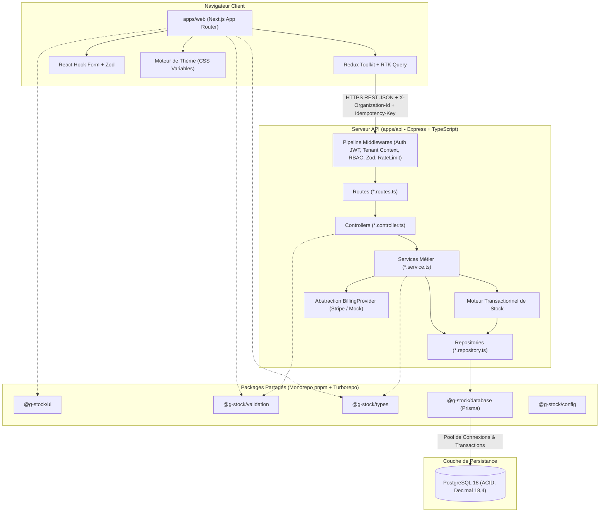
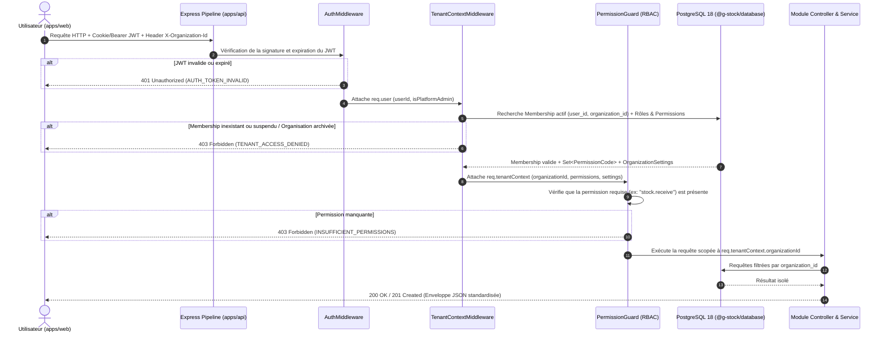
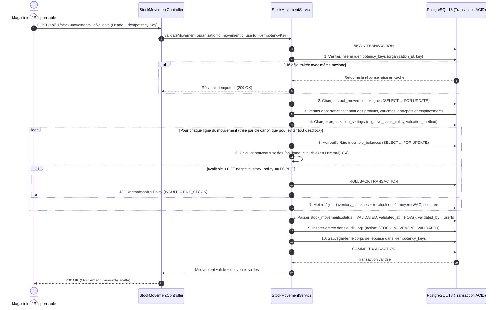

# Architecture Technique — G-Stock

## 1. Vue d'Ensemble & Organisation du Monorepo

Le projet **G-Stock** est structuré en **monorepo** géré par **`pnpm` workspaces** et orchestré par **`Turborepo`**. Ce choix garantit un partage strict des types TypeScript, des schémas de validation Zod, de la couche d'accès aux données Prisma et du système de composants UI entre le frontend et le backend, tout en optimisant les temps de compilation et de test grâce au cache intelligent de Turborepo.

### Arborescence du Monorepo

```text
g-stocks/
├── apps/
│   ├── web/                        # Application Frontend Next.js (App Router)
│   └── api/                        # Serveur API REST modulaire Express + TypeScript
├── packages/
│   ├── database/                   # @g-stock/database   (Schéma Prisma, client, migrations, seeds)
│   ├── validation/                 # @g-stock/validation (Schémas Zod partagés client/serveur)
│   ├── types/                      # @g-stock/types      (Interfaces, DTOs, enums métiers, contrats API)
│   ├── ui/                         # @g-stock/ui         (Design System, composants React + Tailwind)
│   └── config/                     # @g-stock/config     (Configs TS, ESLint, Prettier, constantes)
├── docs/                           # Documentation technique et fonctionnelle de référence
├── package.json                    # Scripts racines et moteurs (Node >= 20, pnpm >= 9)
├── pnpm-workspace.yaml             # Déclaration des espaces de travail apps/* et packages/*
└── turbo.json                      # Pipeline Turborepo (build, dev, lint, typecheck, test)
```

---

## 2. Stack Technique Détaillée

### 2.1. Frontend (`apps/web`)
- **Framework** : **Next.js** (App Router) avec **React** et **TypeScript** en mode `strict`.
- **Stylisation & Thématisation** : **Tailwind CSS** couplé à un moteur de **CSS Custom Properties (Design Tokens)** injectés dynamiquement selon la configuration de l'organisation (`organization_themes`) et les préférences de l'utilisateur (`user_preferences`).
- **Gestion d'État & Cache Réseau** : **Redux Toolkit (RTK)** pour l'état global applicatif (session active, organisation courante `activeOrganizationId`, préférences UI, notifications) et **RTK Query** pour les appels API, l'invalidation automatique par tags (`Products`, `StockBalances`, `Movements`, `Inventories`, `Members`, `Theme`) et la mise à jour optimiste.
- **Formulaires & Validation** : **React Hook Form** connecté aux schémas **Zod** issus de `@g-stock/validation` via `@hookform/resolvers/zod`.
- **Visualisation de Données** : **Recharts** pour les graphiques d'évolution de valorisation, les flux d'entrées/sorties et la répartition des stocks par entrepôt/catégorie.

### 2.2. Backend API (`apps/api`)
- **Serveur HTTP** : **Express.js** avec **TypeScript**, structuré selon une architecture modulaire par domaine métier (Clean / Layered Modular Architecture).
- **Sécurité & Middlewares** : `helmet` (en-têtes HTTP sécurisés), `cors` strict, `cookie-parser`, limitation de débit (`rate-limiting`), middleware de corrélation (`X-Request-Id`), résolution du contexte d'authentification et du tenant (`X-Organization-Id`), et gestionnaire d'erreurs centralisé normalisé.
- **Structure standardisée d'un module métier (`apps/api/src/modules/<domaine>/`)** :
  Chaque domaine fonctionnel (`auth`, `organizations`, `members`, `roles`, `products`, `categories`, `warehouses`, `stock-movements`, `inventories`, `appearance`, `billing`, `audit`, `platform`) respecte rigoureusement le découpage en 7 fichiers/couches :
  1. `*.routes.ts` : Déclaration des routes Express, attachement des middlewares d'authentification, de contexte tenant, de validation Zod et de vérification de permissions.
  2. `*.controller.ts` : Extraction des paramètres HTTP (`req.params`, `req.query`, `req.body`), appel au service métier et formatage de la réponse HTTP standardisée. Aucune logique métier ni requête Prisma directe.
  3. `*.service.ts` : Logique métier pure, orchestration des règles de gestion, coordination des transactions, appels au journal d'audit et vérification des quotas du plan SaaS.
  4. `*.repository.ts` : Encapsulation des requêtes Prisma avec **filtrage obligatoire par `organization_id`**.
  5. `*.schemas.ts` : Ré-export ou spécialisation des schémas Zod (`params`, `query`, `body`) depuis `@g-stock/validation`.
  6. `*.permissions.ts` : Définition des constantes de permissions requises par action du module et prédicats d'autorisation contextuels.
  7. `*.test.ts` : Tests unitaires et d'intégration du module (cas nominaux, erreurs de validation, isolation inter-tenant, invariants de stock).

### 2.3. Persistance & Base de Données
- **SGBD** : **PostgreSQL 18** (support natif UUIDv7/UUIDv4, performances accrues sur les index B-Tree/GIN, isolation transactionnelle robuste, types `NUMERIC(18,4)` et `TIMESTAMPTZ`).
- **ORM** : **Prisma ORM** centralisé dans `@g-stock/database`, utilisant `Prisma.Decimal` (`decimal.js`) pour garantir l'exactitude arithmétique.

---

## 3. Packages Partagés (`packages/*`)

| Package | Rôle & Responsabilités | Consommateurs |
| :--- | :--- | :--- |
| **`@g-stock/database`** | Contient `schema.prisma`, les migrations SQL, le client Prisma typé, les helpers de transaction et les scripts de seed multi-secteurs. | `apps/api` |
| **`@g-stock/validation`** | Schémas **Zod** pour toutes les entités (produits, mouvements, inventaires, thèmes, authentification, filtres de pagination). Garantit la validation symétrique front/back. | `apps/web`, `apps/api` |
| **`@g-stock/types`** | Types TypeScript partagés, énumérations métiers (`MovementType`, `MovementStatus`, `NegativeStockPolicy`, `ValuationMethod`, `PermissionCode`), enveloppes de réponse API (`ApiResponse<T>`, `PaginatedResponse<T>`). | `apps/web`, `apps/api`, `@g-stock/ui`, `@g-stock/validation` |
| **`@g-stock/ui`** | Bibliothèque de composants React accessibles (WCAG 2.2 AA) basés sur Tailwind CSS et pilotés par CSS Custom Properties (boutons, tables de données denses, badges de statut, modales, cartes KPI). | `apps/web` |
| **`@g-stock/config`** | Configurations partagées TypeScript (`tsconfig.base.json`), ESLint, Prettier et constantes globales de la plateforme. | Tous les packages et applications |

---

## 4. Diagrammes d'Architecture

### 4.1. Architecture Globale du Système



---

### 4.2. Flux d'Authentification, Résolution du Tenant et Autorisation RBAC

Chaque requête ciblant une route protégée d'organisation franchit une chaîne de vérification stricte avant d'atteindre le contrôleur :



---

### 4.3. Flux Transactionnel d'un Mouvement de Stock

La validation d'un mouvement de stock (`receipt`, `issue`, `transfer`, `adjustment`) s'exécute intégralement dans une transaction PostgreSQL atomique gérant l'idempotence, le verrouillage des soldes, la politique de stock négatif et le journal d'audit :


