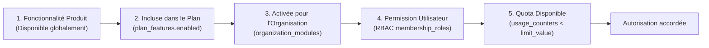
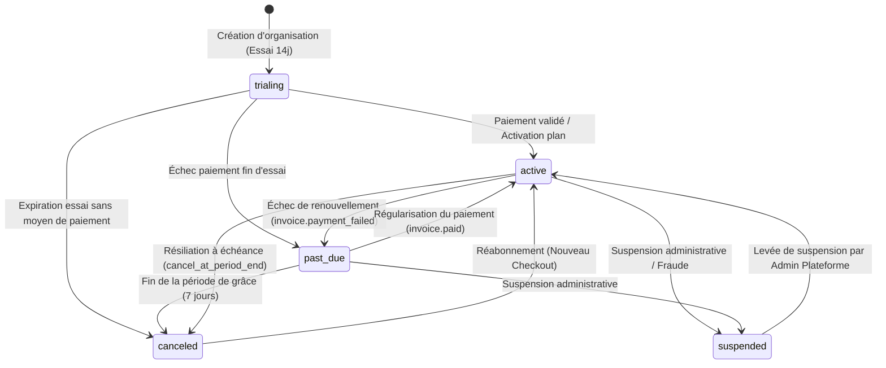

# Modèle SaaS, Droits (Entitlements), Quotas et Facturation

> **Version :** 1.1  
> **Produit :** G-Stock  
> **Portée :** Moteur de droits à 5 niveaux, plans et quotas configurables, abstraction `BillingProvider` (`Stripe` + `DevSimulated`), cycle de vie des abonnements et politique d'accès en cas d'expiration.

---

## 1. Moteur de Droits SaaS à 5 Niveaux (Entitlement Engine)

Dans **G-Stock**, aucune fonctionnalité, création de ressource ou opération sensible n'est autorisée sur la base d'un simple contrôle d'interface. Chaque requête passe par un **moteur d'évaluation à 5 niveaux** exécuté côté serveur avant l'ouverture de la transaction métier.



### Détail des 5 niveaux de contrôle

| Niveau | Vérification | Source de vérité | Code d'erreur en cas de refus |
| :--- | :--- | :--- | :--- |
| **1. Disponibilité Produit** | La fonctionnalité ou le module existe-t-il et est-il activé au niveau global de la plateforme G-Stock ? | Registre des modules plateforme (`platform_modules`) | `403 FEATURE_DISABLED_GLOBALLY` |
| **2. Inclusion dans le Plan** | Le plan associé à l'abonnement de l'entreprise inclut-il cette clé de fonctionnalité (`feature_key`) et l'abonnement autorise-t-il l'opération ? | `subscriptions` + `plans` + `plan_features` | `403 PLAN_UPGRADE_REQUIRED` ou `402 SUBSCRIPTION_READ_ONLY` |
| **3. Activation Organisation** | L'administrateur de l'entreprise a-t-il activé ce module pour son espace de travail ? | `organization_modules` | `403 MODULE_NOT_ENABLED` |
| **4. Permission Utilisateur (RBAC)** | Le membre authentifié possède-t-il la permission requise (ex. `products.create`, `appearance.manage`) sur l'entrepôt ou la ressource ? | `memberships` + `membership_roles` + `role_permissions` | `403 FORBIDDEN` |
| **5. Quota Disponible** | La consommation actuelle de l'organisation est-elle strictement inférieure au plafond configuré dans le plan (`limit_value`) ? | `usage_counters` ou `COUNT(*)` transactionnel vs `plan_features.limit_value` | `403 QUOTA_EXCEEDED` |

> **Principe de refus par défaut (Fail-Closed) :** Si l'un quelconque des 5 niveaux échoue, l'opération est immédiatement refusée côté serveur avec un code explicite permettant à l'interface d'afficher une explication claire (ex. invitation à contacter le propriétaire du compte ou à passer au plan supérieur).

---

## 2. Plans par Défaut et Quotas Configurables

Les plans et leurs limites sont stockés en base de données (`plans` et `plan_features`) et **modifiables dynamiquement depuis le back-office d'administration plateforme (`/admin/plans`)** sans nécessiter de modification de code ni de redéploiement.

### 2.1 Matrice des Plans par Défaut (`starter`, `pro`, `enterprise`)

| Clé (`feature_key`) | Type | Description | Plan `starter` (Essentiel) | Plan `pro` (Croissance) | Plan `enterprise` (Sur-mesure) |
| :--- | :--- | :--- | :--- | :--- | :--- |
| **Tarif indicatif (mensuel)** | Monétaire | Prix de référence HT / mois | `29.00 EUR` | `99.00 EUR` | `299.00 EUR` |
| `max_users` | Quota numérique | Nombre maximum de membres actifs (`ACTIVE` + invitations en attente) | `3` utilisateurs | `15` utilisateurs | `100` (ou illimité `null`) |
| `max_warehouses` | Quota numérique | Nombre maximum d'entrepôts actifs dans l'organisation | `1` entrepôt | `5` entrepôts | `50` (ou illimité `null`) |
| `max_products` | Quota numérique | Nombre maximum de références produits actives au catalogue | `250` produits | `5 000` produits | `100 000` (ou illimité `null`) |
| `custom_branding` | Booléen + Quota | Upload de logo d'entreprise, personnalisation avancée des couleurs hexadécimales et option `force_brand_theme` | `false` (Thèmes prédéfinis uniquement) | `true` | `true` |
| `advanced_inventory` | Booléen | Campagnes d'inventaire multi-emplacements, filtrage par écarts et exports détaillés d'inventaire | `false` (Ajustements simples + inventaire standard) | `true` | `true` |
| `audit_logs` | Booléen + Rétention | Consultation complète et filtrage du journal d'audit des actions sensibles dans l'interface | `false` (Journalisé en base mais interface réservée Pro+) | `true` (Rétention 1 an) | `true` (Rétention étendue + export) |

> **Convention sur `limit_value` :**
> - Pour un quota numérique : un entier positif (ex. `250`) fixe le plafond ; la valeur `null` signifie **illimité**.
> - Pour une fonctionnalité booléenne : `enabled = true` active le droit, `enabled = false` le désactive.

### 2.2 Suivi des Compteurs d'Usage (`usage_counters`)
- Les ressources structurantes (`max_users`, `max_warehouses`, `max_products`) sont vérifiées de manière atomique lors de la création (`POST /members`, `POST /warehouses`, `POST /products`) et synchronisées dans `usage_counters`.
- L'archivage ou la désactivation d'un produit ou d'un membre libère immédiatement l'unité de quota correspondante.
- Si une entreprise rétrograde vers un plan inférieur (ex. de `pro` à `starter`) alors qu'elle possède déjà 400 produits :
  - **Aucune donnée existante n'est supprimée ni masquée.**
  - La création de nouveaux produits (`POST /products`) est bloquée (`403 QUOTA_EXCEEDED`) tant que le nombre de produits actifs dépasse la limite du nouveau plan (`250`).

---

## 3. Architecture d'Abstraction de Paiement (`BillingProvider`)

Afin de ne jamais coupler le noyau métier de G-Stock à un prestataire de paiement unique et de permettre le développement, les tests automatisés et les démonstrations sans dépendance externe non configurée, toute l'intégration financière passe par l'interface `BillingProvider`.

### 3.1 Contrat TypeScript `BillingProvider`

```typescript
export interface CheckoutSessionInput {
  organizationId: string;
  organizationName: string;
  billingEmail: string;
  planCode: 'starter' | 'pro' | 'enterprise';
  billingInterval: 'MONTHLY' | 'YEARLY';
  successUrl: string;
  cancelUrl: string;
}

export interface CheckoutSessionResult {
  provider: 'stripe' | 'dev_simulated';
  simulated: boolean;
  checkoutUrl: string;
  providerSessionId: string;
}

export interface VerifiedWebhookEvent {
  externalEventId: string;
  eventType:
    | 'subscription.created'
    | 'subscription.updated'
    | 'subscription.past_due'
    | 'subscription.canceled'
    | 'invoice.paid'
    | 'invoice.payment_failed';
  organizationId: string;
  planCode?: string;
  providerCustomerId?: string;
  providerSubscriptionId?: string;
  currentPeriodStart?: Date;
  currentPeriodEnd?: Date;
  rawPayloadSanitized: Record<string, unknown>;
}

export interface BillingProvider {
  readonly providerName: 'stripe' | 'dev_simulated';
  readonly isConfigured: boolean;

  createCheckoutSession(input: CheckoutSessionInput): Promise<CheckoutSessionResult>;
  createCustomerPortalSession(organizationId: string, returnUrl: string): Promise<{ portalUrl: string }>;
  verifyAndParseWebhook(rawBody: Buffer | string, signatureHeader: string): Promise<VerifiedWebhookEvent>;
  cancelSubscriptionAtPeriodEnd(providerSubscriptionId: string): Promise<void>;
}
```

### 3.2 Les Deux Implémentations

#### A. `StripeBillingProvider` (Production & Staging connecté)
- Activé lorsque `BILLING_PROVIDER=stripe` et que les variables `STRIPE_SECRET_KEY` et `STRIPE_WEBHOOK_SECRET` sont renseignées.
- Crée des sessions Stripe Checkout réelles et délègue la gestion des moyens de paiement au Customer Portal Stripe (aucune donnée de carte bancaire ne transite par les serveurs G-Stock — conformité PCI-DSS SAQ-A).
- Vérifie la signature cryptographique `Stripe-Signature` (HMAC-SHA256 avec tolérance d'horodatage) sur `POST /api/v1/billing/webhooks/stripe`.

#### B. `DevSimulatedBillingProvider` (Développement, Tests & Démonstration sans clé externe)
- Activé automatiquement lorsque `BILLING_PROVIDER=dev_simulated` ou lorsque les clés Stripe ne sont pas configurées en environnement de développement.
- **Transparence totale dans l'UI :** Conformément à la règle impérative du projet, l'interface affiche un bandeau explicite *« Mode de facturation simulé (Développement) — Aucun prélèvement réel n'est effectué »*.
- Permet de tester l'intégralité des transitions de plans (`starter` $\leftrightarrow$ `pro` $\leftrightarrow$ `enterprise`) et de simuler les statuts d'abonnement (`trialing`, `active`, `past_due`, `canceled`, `suspended`) ainsi que la réception de webhooks signés avec `DEV_WEBHOOK_SECRET`.

### 3.3 Idempotence et Sécurité des Webhooks (`billing_webhook_events`)
1. Chaque événement entrant possède un `external_event_id` unique.
2. Avant tout traitement, le service vérifie l'existence de `external_event_id` dans `billing_webhook_events`. Si l'événement a déjà le statut `PROCESSED`, l'API répond immédiatement `200 OK` sans retraiter la mutation.
3. Les payloads d'erreur ou métadonnées enregistrés dans `billing_webhook_events` et `audit_logs` sont systématiquement expurgés des jetons et informations personnelles sensibles.

---

## 4. Cycle de Vie des Abonnements et Politique d'Accès

### 4.1 Diagramme d'États de l'Abonnement



### 4.2 Comportement Applicatif par Statut et Politique d'Expiration

> **Règle d'or absolue :** **G-Stock ne supprime jamais automatiquement les données d'une entreprise** (produits, historique de mouvements, inventaires, journaux d'audit) lorsque son essai ou son abonnement expire.

| Statut (`subscriptions.status`) | Signification Métier | Lecture des données & Exports (`GET`) | Opérations d'écriture (`POST`, `PUT`, `PATCH`, `DELETE` métier) | Souscription / Régularisation (`/billing/*`) | Bannière dans l'Interface |
| :--- | :--- | :--- | :--- | :--- | :--- |
| **`trialing`** | Période d'essai gratuite en cours (avant `trial_end`). | **Autorisée** | **Autorisées** (selon quotas du plan d'essai) | **Autorisée** | Badge informatif indiquant le nombre de jours d'essai restants. |
| **`active`** | Abonnement payé et à jour (`current_period_end` futur). | **Autorisée** | **Autorisées** (selon quotas du plan actif) | **Autorisée** | Aucune alerte (affichage normal dans Paramètres → Facturation). |
| **`past_due`** | Échec du dernier prélèvement ; **période de grâce de 7 jours** active. | **Autorisée** | **Autorisées** pendant la période de grâce pour ne pas bloquer l'exploitation logistique en cours. | **Autorisée** | Bannière d'avertissement orange (`--color-warning`) invitant le propriétaire à mettre à jour son moyen de paiement. |
| **`canceled`** | Abonnement résilié ou essai expiré au-delà de la période de grâce. | **Autorisée (Lecture seule conservée)** : consultation des stocks, mouvements, rapports et export CSV. | **Bloquées (`402 SUBSCRIPTION_READ_ONLY`)** : impossible de créer des produits, mouvements ou inventaires. | **Autorisée** (permet de réactiver l'espace à tout moment). | Bannière critique rouge (`--color-danger`) indiquant que l'espace est en **mode lecture seule** jusqu'au renouvellement. |
| **`suspended`** | Suspension administrative prononcée ou non-paiement prolongé sévère. | **Autorisée en lecture seule** pour le propriétaire (`OWNER`) ; restreinte pour les autres rôles selon décision admin. | **Bloquées (`402 SUBSCRIPTION_READ_ONLY`)** | **Autorisée** (ou contact support plateforme). | Bannière de suspension avec instructions de régularisation. |
