# Schéma de Base de Données — G-Stock

## 1. Conventions SQL & Prisma

Le schéma de base de données de **G-Stock** cible **PostgreSQL 18** via **Prisma ORM** (`@g-stock/database`). Il respecte des conventions d'ingénierie strictes pour garantir l'intégrité financière, la traçabilité temporelle et l'isolation multi-tenant :

1. **Identifiants primaires (`id`)** : Toutes les tables utilisent des `UUID` (`@id @default(uuid()) @db.Uuid`). Aucun entier auto-incrémenté séquentiel n'est exposé dans les URLs ou API publiques afin d'empêcher toute énumération prédictible inter-tenant.
2. **Horodatages (`timestamptz`)** : Toutes les dates et heures d'événements (`created_at`, `updated_at`, `validated_at`, `expires_at`, `counted_at`) sont stockées en **`TIMESTAMPTZ` (UTC)** (`@db.Timestamptz(6)`). La conversion dans le fuseau horaire de l'organisation (`organization_settings.timezone`) s'effectue uniquement à l'affichage.
3. **Précision Décimale Financière & Physique (`Decimal(18,4)`)** : **L'usage de `FLOAT`, `REAL` ou `DOUBLE PRECISION` est formellement interdit** pour les quantités de stock, les facteurs de conversion, les prix et les coûts. Toutes ces colonnes utilisent `NUMERIC(18, 4)` (`@db.Decimal(18, 4)`), offrant jusqu'à 14 chiffres avant la virgule et 4 décimales exactes après la virgule.
4. **Isolation et Unicité par Organisation** : Toutes les tables métiers portent une clé étrangère obligatoire `organization_id UUID NOT NULL` indexée. Les contraintes d'unicité métier (codes SKU, codes d'entrepôts, codes d'emplacements, slugs de catégories, numéros de mouvements, clés d'idempotence) sont systématiquement composites et scopées au tenant : `UNIQUE (organization_id, <colonne_metier>)`.
5. **Nommage** : Tables et colonnes en `snake_case` dans PostgreSQL (`@@map` / `@map` dans Prisma), modèles en `PascalCase` et propriétés en `camelCase` dans le client TypeScript.

---

## 2. Dictionnaire Complet des Tables (33 Tables)

### 2.1. Domaine 1 : Identité, Multi-Tenant & RBAC (9 tables)

#### 1. `users`
Comptes utilisateurs globaux de la plateforme (un utilisateur peut rejoindre plusieurs organisations).
- `id` (`UUID`, PK)
- `email` (`VARCHAR(255)`, UNIQUE, normalisé en minuscules)
- `password_hash` (`TEXT`, NOT NULL) — Hachage Argon2id / Scrypt / Bcrypt
- `full_name` (`VARCHAR(150)`, NOT NULL)
- `avatar_url` (`TEXT`, NULL)
- `is_platform_admin` (`BOOLEAN`, NOT NULL, DEFAULT `false`) — Privilège Super-Admin G-Stock
- `is_active` (`BOOLEAN`, NOT NULL, DEFAULT `true`)
- `last_login_at` (`TIMESTAMPTZ`, NULL)
- `created_at` (`TIMESTAMPTZ`, NOT NULL, DEFAULT `now()`)
- `updated_at` (`TIMESTAMPTZ`, NOT NULL)

#### 2. `organizations`
Entité racine représentant un client (tenant) sur la plateforme.
- `id` (`UUID`, PK)
- `name` (`VARCHAR(150)`, NOT NULL)
- `slug` (`VARCHAR(100)`, UNIQUE, NOT NULL) — Identifiant URL lisible
- `industry_sector` (`VARCHAR(60)`, NOT NULL, DEFAULT `'general'`) — Secteur d'activité (retail, wholesale, logistics, hospitality, pharmacy, fashion, automotive, construction, manufacturing)
- `status` (`VARCHAR(30)`, NOT NULL, DEFAULT `'ACTIVE'`) — `ACTIVE`, `SUSPENDED`, `ARCHIVED`
- `created_by_user_id` (`UUID`, FK `users.id`, NULL)
- `created_at` (`TIMESTAMPTZ`, NOT NULL, DEFAULT `now()`)
- `updated_at` (`TIMESTAMPTZ`, NOT NULL)

#### 3. `memberships`
Lien d'appartenance entre un utilisateur et une organisation.
- `id` (`UUID`, PK)
- `organization_id` (`UUID`, FK `organizations.id` ON DELETE CASCADE, NOT NULL)
- `user_id` (`UUID`, FK `users.id` ON DELETE CASCADE, NOT NULL)
- `status` (`VARCHAR(30)`, NOT NULL, DEFAULT `'ACTIVE'`) — `INVITED`, `ACTIVE`, `SUSPENDED`, `REVOKED`
- `default_warehouse_id` (`UUID`, FK `warehouses.id` ON DELETE SET NULL, NULL)
- `joined_at` (`TIMESTAMPTZ`, NOT NULL, DEFAULT `now()`)
- `created_at` (`TIMESTAMPTZ`, NOT NULL, DEFAULT `now()`)
- `updated_at` (`TIMESTAMPTZ`, NOT NULL)
- **Contrainte** : `UNIQUE (organization_id, user_id)`

#### 4. `roles`
Rôles définis au sein d'une organisation (rôles systèmes initialisés automatiquement ou rôles personnalisés).
- `id` (`UUID`, PK)
- `organization_id` (`UUID`, FK `organizations.id` ON DELETE CASCADE, NOT NULL)
- `code` (`VARCHAR(60)`, NOT NULL) — ex: `OWNER`, `ADMIN`, `STOCK_MANAGER`, `WAREHOUSE_OPERATOR`, `AUDITOR`, ou code personnalisé
- `name` (`VARCHAR(100)`, NOT NULL)
- `description` (`TEXT`, NULL)
- `is_system` (`BOOLEAN`, NOT NULL, DEFAULT `false`) — Non supprimable si `true`
- `created_at` (`TIMESTAMPTZ`, NOT NULL, DEFAULT `now()`)
- `updated_at` (`TIMESTAMPTZ`, NOT NULL)
- **Contrainte** : `UNIQUE (organization_id, code)`

#### 5. `permissions`
Catalogue global des permissions atomiques du système.
- `id` (`UUID`, PK)
- `code` (`VARCHAR(80)`, UNIQUE, NOT NULL) — ex: `products.read`, `stock.receive`, `inventory.validate`
- `module` (`VARCHAR(50)`, NOT NULL) — ex: `products`, `stock`, `inventory`, `settings`
- `description` (`TEXT`, NOT NULL)
- `created_at` (`TIMESTAMPTZ`, NOT NULL, DEFAULT `now()`)

#### 6. `role_permissions`
Table de jointure attribuant les permissions aux rôles.
- `role_id` (`UUID`, FK `roles.id` ON DELETE CASCADE, NOT NULL)
- `permission_id` (`UUID`, FK `permissions.id` ON DELETE CASCADE, NOT NULL)
- `created_at` (`TIMESTAMPTZ`, NOT NULL, DEFAULT `now()`)
- **Clé primaire composite** : `PRIMARY KEY (role_id, permission_id)`

#### 7. `membership_roles`
Table de jointure attribuant un ou plusieurs rôles à un membre d'organisation.
- `membership_id` (`UUID`, FK `memberships.id` ON DELETE CASCADE, NOT NULL)
- `role_id` (`UUID`, FK `roles.id` ON DELETE CASCADE, NOT NULL)
- `assigned_at` (`TIMESTAMPTZ`, NOT NULL, DEFAULT `now()`)
- **Clé primaire composite** : `PRIMARY KEY (membership_id, role_id)`

#### 8. `invitations`
Invitations envoyées par email pour rejoindre une organisation.
- `id` (`UUID`, PK)
- `organization_id` (`UUID`, FK `organizations.id` ON DELETE CASCADE, NOT NULL)
- `email` (`VARCHAR(255)`, NOT NULL)
- `role_id` (`UUID`, FK `roles.id` ON DELETE CASCADE, NOT NULL)
- `token_hash` (`VARCHAR(128)`, UNIQUE, NOT NULL) — Empreinte SHA-256 du jeton d'invitation
- `status` (`VARCHAR(30)`, NOT NULL, DEFAULT `'PENDING'`) — `PENDING`, `ACCEPTED`, `EXPIRED`, `REVOKED`
- `invited_by_user_id` (`UUID`, FK `users.id`, NOT NULL)
- `expires_at` (`TIMESTAMPTZ`, NOT NULL)
- `accepted_at` (`TIMESTAMPTZ`, NULL)
- `created_at` (`TIMESTAMPTZ`, NOT NULL, DEFAULT `now()`)
- **Index** : `INDEX (organization_id, email, status)`

#### 9. `organization_settings`
Paramètres métiers et comptables propres à chaque organisation (relation 1:1 avec `organizations`).
- `id` (`UUID`, PK)
- `organization_id` (`UUID`, UNIQUE, FK `organizations.id` ON DELETE CASCADE, NOT NULL)
- `default_currency` (`CHAR(3)`, NOT NULL, DEFAULT `'EUR'`) — Code ISO 4217 (`EUR`, `USD`, `XOF`, `CAD`, etc.)
- `timezone` (`VARCHAR(64)`, NOT NULL, DEFAULT `'Europe/Paris'`)
- `locale` (`VARCHAR(15)`, NOT NULL, DEFAULT `'fr-FR'`)
- `negative_stock_policy` (`VARCHAR(20)`, NOT NULL, DEFAULT `'FORBID'`) — `FORBID`, `WARN`, `ALLOW`
- `valuation_method` (`VARCHAR(20)`, NOT NULL, DEFAULT `'WAC'`) — `WAC`, `LAST_COST`
- `default_movement_status` (`VARCHAR(20)`, NOT NULL, DEFAULT `'DRAFT'`) — `DRAFT`, `VALIDATED`
- `require_movement_reason_on_adjust` (`BOOLEAN`, NOT NULL, DEFAULT `true`)
- `default_low_stock_threshold` (`DECIMAL(18,4)`, NOT NULL, DEFAULT `5.0000`)
- `movement_sequence_prefix` (`VARCHAR(15)`, NOT NULL, DEFAULT `'MOV-'`)
- `inventory_sequence_prefix` (`VARCHAR(15)`, NOT NULL, DEFAULT `'INV-'`)
- `updated_at` (`TIMESTAMPTZ`, NOT NULL)

---

### 2.2. Domaine 2 : Apparence, Thèmes & Préférences (4 tables)

#### 10. `organization_branding`
Identité visuelle de marque blanche de l'organisation (relation 1:1 avec `organizations`).
- `id` (`UUID`, PK)
- `organization_id` (`UUID`, UNIQUE, FK `organizations.id` ON DELETE CASCADE, NOT NULL)
- `display_name` (`VARCHAR(150)`, NOT NULL)
- `logo_light_url` (`TEXT`, NULL)
- `logo_dark_url` (`TEXT`, NULL)
- `favicon_url` (`TEXT`, NULL)
- `brand_tagline` (`VARCHAR(255)`, NULL)
- `support_email` (`VARCHAR(255)`, NULL)
- `updated_at` (`TIMESTAMPTZ`, NOT NULL)

#### 11. `organization_themes`
Jetons de design (Design Tokens CSS) configurés par l'organisation avec validation WCAG 2.2 AA.
- `id` (`UUID`, PK)
- `organization_id` (`UUID`, UNIQUE, FK `organizations.id` ON DELETE CASCADE, NOT NULL)
- `preset_name` (`VARCHAR(50)`, NOT NULL, DEFAULT `'cobalt-industrial'`)
- `primary_color` (`VARCHAR(25)`, NOT NULL, DEFAULT `'#1D4ED8'`)
- `secondary_color` (`VARCHAR(25)`, NOT NULL, DEFAULT `'#0F172A'`)
- `accent_color` (`VARCHAR(25)`, NOT NULL, DEFAULT `'#0284C7'`)
- `surface_light` (`VARCHAR(25)`, NOT NULL, DEFAULT `'#FFFFFF'`)
- `surface_dark` (`VARCHAR(25)`, NOT NULL, DEFAULT `'#0B0F19'`)
- `border_radius_scale` (`VARCHAR(20)`, NOT NULL, DEFAULT `'md'`) — `none`, `sm`, `md`, `lg`, `full`
- `font_family_sans` (`VARCHAR(80)`, NOT NULL, DEFAULT `'Inter'`)
- `font_family_mono` (`VARCHAR(80)`, NOT NULL, DEFAULT `'JetBrains Mono'`)
- `custom_tokens_json` (`JSONB`, NOT NULL, DEFAULT `'{}'`) — Variables CSS additionnelles validées
- `wcag_contrast_verified` (`BOOLEAN`, NOT NULL, DEFAULT `true`)
- `updated_at` (`TIMESTAMPTZ`, NOT NULL)

#### 12. `user_preferences`
Préférences ergonomiques personnelles d'un utilisateur (globales ou par organisation).
- `id` (`UUID`, PK)
- `user_id` (`UUID`, UNIQUE, FK `users.id` ON DELETE CASCADE, NOT NULL)
- `theme_mode` (`VARCHAR(20)`, NOT NULL, DEFAULT `'system'`) — `light`, `dark`, `system`
- `table_density` (`VARCHAR(20)`, NOT NULL, DEFAULT `'comfortable'`) — `compact`, `comfortable`, `spacious`
- `sidebar_collapsed` (`BOOLEAN`, NOT NULL, DEFAULT `false`)
- `locale` (`VARCHAR(15)`, NOT NULL, DEFAULT `'fr-FR'`)
- `items_per_page` (`INTEGER`, NOT NULL, DEFAULT `25`)
- `updated_at` (`TIMESTAMPTZ`, NOT NULL)

#### 13. `saved_views`
Vues filtrées, tris et configurations de colonnes sauvegardées par les utilisateurs sur les listes (produits, mouvements, stocks).
- `id` (`UUID`, PK)
- `organization_id` (`UUID`, FK `organizations.id` ON DELETE CASCADE, NOT NULL)
- `user_id` (`UUID`, FK `users.id` ON DELETE CASCADE, NOT NULL)
- `resource_type` (`VARCHAR(50)`, NOT NULL) — `PRODUCTS`, `STOCK_BALANCES`, `STOCK_MOVEMENTS`, `INVENTORIES`
- `name` (`VARCHAR(100)`, NOT NULL)
- `is_shared` (`BOOLEAN`, NOT NULL, DEFAULT `false`) — Visible par toute l'organisation si `true`
- `is_default` (`BOOLEAN`, NOT NULL, DEFAULT `false`)
- `filters_json` (`JSONB`, NOT NULL, DEFAULT `'{}'`)
- `sort_json` (`JSONB`, NOT NULL, DEFAULT `'{}'`)
- `columns_json` (`JSONB`, NOT NULL, DEFAULT `'[]'`)
- `created_at` (`TIMESTAMPTZ`, NOT NULL, DEFAULT `now()`)
- `updated_at` (`TIMESTAMPTZ`, NOT NULL)

---

### 2.3. Domaine 3 : Catalogue Produits, Unités & Attributs Dynamiques (7 tables)

#### 14. `categories`
Classification hiérarchique des produits par organisation.
- `id` (`UUID`, PK)
- `organization_id` (`UUID`, FK `organizations.id` ON DELETE CASCADE, NOT NULL)
- `parent_id` (`UUID`, FK `categories.id` ON DELETE SET NULL, NULL)
- `name` (`VARCHAR(120)`, NOT NULL)
- `slug` (`VARCHAR(140)`, NOT NULL)
- `description` (`TEXT`, NULL)
- `sort_order` (`INTEGER`, NOT NULL, DEFAULT `0`)
- `is_active` (`BOOLEAN`, NOT NULL, DEFAULT `true`)
- `created_at` (`TIMESTAMPTZ`, NOT NULL, DEFAULT `now()`)
- `updated_at` (`TIMESTAMPTZ`, NOT NULL)
- **Contrainte** : `UNIQUE (organization_id, slug)`

#### 15. `units_of_measure`
Unités de mesure utilisées par l'organisation (ex: Unité `PCS`, Kilogramme `KG`, Carton de 12 `BOX12`).
- `id` (`UUID`, PK)
- `organization_id` (`UUID`, FK `organizations.id` ON DELETE CASCADE, NOT NULL)
- `code` (`VARCHAR(20)`, NOT NULL)
- `name` (`VARCHAR(80)`, NOT NULL)
- `symbol` (`VARCHAR(20)`, NOT NULL)
- `category` (`VARCHAR(30)`, NOT NULL, DEFAULT `'QUANTITY'`) — `QUANTITY`, `WEIGHT`, `VOLUME`, `LENGTH`, `AREA`, `PACKAGING`
- `decimal_places` (`INTEGER`, NOT NULL, DEFAULT `0`) — `0` à `4`
- `is_active` (`BOOLEAN`, NOT NULL, DEFAULT `true`)
- `created_at` (`TIMESTAMPTZ`, NOT NULL, DEFAULT `now()`)
- **Contrainte** : `UNIQUE (organization_id, code)`

#### 16. `unit_conversions`
Facteurs de conversion exacts entre deux unités au sein d'une organisation (ou spécifiques à un produit).
- `id` (`UUID`, PK)
- `organization_id` (`UUID`, FK `organizations.id` ON DELETE CASCADE, NOT NULL)
- `product_id` (`UUID`, FK `products.id` ON DELETE CASCADE, NULL) — `NULL` = conversion standard globale au tenant
- `from_unit_id` (`UUID`, FK `units_of_measure.id` ON DELETE RESTRICT, NOT NULL)
- `to_unit_id` (`UUID`, FK `units_of_measure.id` ON DELETE RESTRICT, NOT NULL)
- `conversion_factor` (`DECIMAL(18,4)`, NOT NULL) — ex: `1 Palette = 48.0000 Cartons` (`conversion_factor > 0`)
- `created_at` (`TIMESTAMPTZ`, NOT NULL, DEFAULT `now()`)
- **Contrainte** : `UNIQUE (organization_id, product_id, from_unit_id, to_unit_id)`

#### 17. `products`
Entité principale du catalogue d'articles.
- `id` (`UUID`, PK)
- `organization_id` (`UUID`, FK `organizations.id` ON DELETE CASCADE, NOT NULL)
- `category_id` (`UUID`, FK `categories.id` ON DELETE SET NULL, NULL)
- `base_unit_id` (`UUID`, FK `units_of_measure.id` ON DELETE RESTRICT, NOT NULL)
- `sku` (`VARCHAR(80)`, NOT NULL) — Référence article unique dans l'organisation
- `barcode` (`VARCHAR(80)`, NULL) — EAN-13, UPC, Code 128
- `name` (`VARCHAR(200)`, NOT NULL)
- `description` (`TEXT`, NULL)
- `has_variants` (`BOOLEAN`, NOT NULL, DEFAULT `false`)
- `track_inventory` (`BOOLEAN`, NOT NULL, DEFAULT `true`)
- `purchase_price` (`DECIMAL(18,4)`, NOT NULL, DEFAULT `0.0000`) — Prix d'achat catalogue par défaut
- `selling_price` (`DECIMAL(18,4)`, NOT NULL, DEFAULT `0.0000`) — Prix de vente HT indicatif
- `weighted_average_cost` (`DECIMAL(18,4)`, NOT NULL, DEFAULT `0.0000`) — CMUP courant (`WAC`)
- `last_purchase_cost` (`DECIMAL(18,4)`, NOT NULL, DEFAULT `0.0000`) — Dernier coût d'entrée validé (`LAST_COST`)
- `reorder_point` (`DECIMAL(18,4)`, NOT NULL, DEFAULT `0.0000`) — Seuil de réapprovisionnement
- `safety_stock` (`DECIMAL(18,4)`, NOT NULL, DEFAULT `0.0000`) — Stock de sécurité critique
- `max_stock_level` (`DECIMAL(18,4)`, NULL)
- `lead_time_days` (`INTEGER`, NULL, DEFAULT `0`)
- `image_url` (`TEXT`, NULL)
- `status` (`VARCHAR(20)`, NOT NULL, DEFAULT `'ACTIVE'`) — `ACTIVE`, `INACTIVE`, `ARCHIVED`
- `created_at` (`TIMESTAMPTZ`, NOT NULL, DEFAULT `now()`)
- `updated_at` (`TIMESTAMPTZ`, NOT NULL)
- **Contraintes & Index** :
  - `UNIQUE (organization_id, sku)`
  - `INDEX (organization_id, barcode)`
  - `INDEX (organization_id, category_id, status)`

#### 18. `product_variants`
Déclinaisons spécifiques d'un produit parent (ex: *T-Shirt Coton Bio — Bleu Marine / Taille L*).
- `id` (`UUID`, PK)
- `organization_id` (`UUID`, FK `organizations.id` ON DELETE CASCADE, NOT NULL)
- `product_id` (`UUID`, FK `products.id` ON DELETE CASCADE, NOT NULL)
- `sku` (`VARCHAR(80)`, NOT NULL)
- `barcode` (`VARCHAR(80)`, NULL)
- `name` (`VARCHAR(200)`, NOT NULL)
- `attributes_summary` (`JSONB`, NOT NULL, DEFAULT `'{}'`) — ex: `{"color": "Navy", "size": "L"}`
- `purchase_price_override` (`DECIMAL(18,4)`, NULL)
- `selling_price_override` (`DECIMAL(18,4)`, NULL)
- `weighted_average_cost` (`DECIMAL(18,4)`, NOT NULL, DEFAULT `0.0000`)
- `last_purchase_cost` (`DECIMAL(18,4)`, NOT NULL, DEFAULT `0.0000`)
- `reorder_point_override` (`DECIMAL(18,4)`, NULL)
- `safety_stock_override` (`DECIMAL(18,4)`, NULL)
- `is_active` (`BOOLEAN`, NOT NULL, DEFAULT `true`)
- `created_at` (`TIMESTAMPTZ`, NOT NULL, DEFAULT `now()`)
- `updated_at` (`TIMESTAMPTZ`, NOT NULL)
- **Contrainte** : `UNIQUE (organization_id, sku)`

#### 19. `product_attribute_definitions`
Définitions des champs personnalisés dynamiques propres à chaque organisation (pour supporter pharmacie, auto, restauration, mode, etc.).
- `id` (`UUID`, PK)
- `organization_id` (`UUID`, FK `organizations.id` ON DELETE CASCADE, NOT NULL)
- `key` (`VARCHAR(60)`, NOT NULL) — ex: `expiry_date`, `oem_reference`, `storage_temp`, `allergens`
- `label` (`VARCHAR(120)`, NOT NULL)
- `data_type` (`VARCHAR(30)`, NOT NULL) — `TEXT`, `NUMBER`, `DECIMAL`, `BOOLEAN`, `DATE`, `SELECT`, `MULTI_SELECT`
- `options_json` (`JSONB`, NULL) — Options autorisées pour `SELECT` / `MULTI_SELECT`
- `is_required` (`BOOLEAN`, NOT NULL, DEFAULT `false`)
- `is_filterable` (`BOOLEAN`, NOT NULL, DEFAULT `true`)
- `applies_to_category_id` (`UUID`, FK `categories.id` ON DELETE SET NULL, NULL)
- `sort_order` (`INTEGER`, NOT NULL, DEFAULT `0`)
- `created_at` (`TIMESTAMPTZ`, NOT NULL, DEFAULT `now()`)
- **Contrainte** : `UNIQUE (organization_id, key)`

#### 20. `product_attribute_values`
Valeurs des attributs dynamiques rattachées à un produit ou une variante.
- `id` (`UUID`, PK)
- `organization_id` (`UUID`, FK `organizations.id` ON DELETE CASCADE, NOT NULL)
- `attribute_definition_id` (`UUID`, FK `product_attribute_definitions.id` ON DELETE CASCADE, NOT NULL)
- `product_id` (`UUID`, FK `products.id` ON DELETE CASCADE, NOT NULL)
- `variant_id` (`UUID`, FK `product_variants.id` ON DELETE CASCADE, NULL)
- `value_text` (`TEXT`, NULL)
- `value_decimal` (`DECIMAL(18,4)`, NULL)
- `value_boolean` (`BOOLEAN`, NULL)
- `value_date` (`TIMESTAMPTZ`, NULL)
- `value_json` (`JSONB`, NULL)
- `updated_at` (`TIMESTAMPTZ`, NOT NULL)
- **Contrainte** : `UNIQUE NULLS NOT DISTINCT (organization_id, attribute_definition_id, product_id, variant_id)`

---

### 2.4. Domaine 4 : Entrepôts, Emplacements & Soldes de Stock (3 tables)

#### 21. `warehouses`
Dépôts physiques ou logiques d'une organisation.
- `id` (`UUID`, PK)
- `organization_id` (`UUID`, FK `organizations.id` ON DELETE CASCADE, NOT NULL)
- `code` (`VARCHAR(40)`, NOT NULL) — ex: `WH-PAR-01`, `BOUTIQUE-LYON`
- `name` (`VARCHAR(150)`, NOT NULL)
- `type` (`VARCHAR(30)`, NOT NULL, DEFAULT `'MAIN'`) — `MAIN`, `STORE`, `TRANSIT`, `QUARANTINE`, `WORKSITE`
- `address_line1` (`VARCHAR(255)`, NULL)
- `city` (`VARCHAR(100)`, NULL)
- `postal_code` (`VARCHAR(30)`, NULL)
- `country_code` (`CHAR(2)`, NULL, DEFAULT `'FR'`)
- `is_default` (`BOOLEAN`, NOT NULL, DEFAULT `false`)
- `is_active` (`BOOLEAN`, NOT NULL, DEFAULT `true`)
- `created_at` (`TIMESTAMPTZ`, NOT NULL, DEFAULT `now()`)
- `updated_at` (`TIMESTAMPTZ`, NOT NULL)
- **Contrainte** : `UNIQUE (organization_id, code)`

#### 22. `locations`
Emplacements internes hiérarchiques au sein d'un entrepôt (Zone → Allée → Rack → Niveau → Bac).
- `id` (`UUID`, PK)
- `organization_id` (`UUID`, FK `organizations.id` ON DELETE CASCADE, NOT NULL)
- `warehouse_id` (`UUID`, FK `warehouses.id` ON DELETE CASCADE, NOT NULL)
- `parent_id` (`UUID`, FK `locations.id` ON DELETE SET NULL, NULL)
- `code` (`VARCHAR(60)`, NOT NULL) — ex: `Z1-A02-R04-B01` ou `DEFAULT-RECEIVING`
- `name` (`VARCHAR(150)`, NOT NULL)
- `type` (`VARCHAR(30)`, NOT NULL, DEFAULT `'STORAGE'`) — `RECEIVING`, `STORAGE`, `PICKING`, `SHIPPING`, `QUARANTINE`, `DAMAGED`
- `is_default` (`BOOLEAN`, NOT NULL, DEFAULT `false`) — Chaque entrepôt possède au moins un emplacement par défaut
- `is_active` (`BOOLEAN`, NOT NULL, DEFAULT `true`)
- `created_at` (`TIMESTAMPTZ`, NOT NULL, DEFAULT `now()`)
- `updated_at` (`TIMESTAMPTZ`, NOT NULL)
- **Contrainte** : `UNIQUE (organization_id, warehouse_id, code)`

#### 23. `inventory_balances`
Table matérialisant en temps réel le solde de stock exact par article, entrepôt et emplacement. Maintenue **exclusivement** par le moteur transactionnel de mouvements.
- `id` (`UUID`, PK)
- `organization_id` (`UUID`, FK `organizations.id` ON DELETE CASCADE, NOT NULL)
- `warehouse_id` (`UUID`, FK `warehouses.id` ON DELETE RESTRICT, NOT NULL)
- `location_id` (`UUID`, FK `locations.id` ON DELETE RESTRICT, NOT NULL)
- `product_id` (`UUID`, FK `products.id` ON DELETE RESTRICT, NOT NULL)
- `variant_id` (`UUID`, FK `product_variants.id` ON DELETE RESTRICT, NULL)
- `on_hand_quantity` (`DECIMAL(18,4)`, NOT NULL, DEFAULT `0.0000`) — Quantité physique présente
- `reserved_quantity` (`DECIMAL(18,4)`, NOT NULL, DEFAULT `0.0000`) — Quantité réservée/engagée ($\ge 0$)
- `available_quantity` (`DECIMAL(18,4)`, NOT NULL, DEFAULT `0.0000`) — Toujours égal à `on_hand_quantity - reserved_quantity`
- `unit_cost_snapshot` (`DECIMAL(18,4)`, NOT NULL, DEFAULT `0.0000`) — Coût unitaire de valorisation courant
- `total_valuation` (`DECIMAL(18,4)`, NOT NULL, DEFAULT `0.0000`) — `on_hand_quantity * unit_cost_snapshot`
- `last_movement_at` (`TIMESTAMPTZ`, NULL)
- `version` (`INTEGER`, NOT NULL, DEFAULT `1`) — Compteur de version optimiste/audit
- `updated_at` (`TIMESTAMPTZ`, NOT NULL)
- **Contrainte d'unicité stricte (PostgreSQL 15+)** :
  `UNIQUE NULLS NOT DISTINCT (organization_id, warehouse_id, location_id, product_id, variant_id)`

---

### 2.5. Domaine 5 : Mouvements de Stock & Inventaires Physiques (4 tables)

#### 24. `stock_movements`
En-tête du grand livre immuable des mouvements de stock.
- `id` (`UUID`, PK)
- `organization_id` (`UUID`, FK `organizations.id` ON DELETE CASCADE, NOT NULL)
- `reference_number` (`VARCHAR(60)`, NOT NULL) — Numéro séquentiel lisible ex: `MOV-2026-000142`
- `type` (`VARCHAR(30)`, NOT NULL) — `receipt`, `issue`, `transfer`, `adjustment`, `opening_balance`, `reversal`
- `status` (`VARCHAR(20)`, NOT NULL, DEFAULT `'DRAFT'`) — `DRAFT`, `VALIDATED`, `CANCELLED`
- `source_warehouse_id` (`UUID`, FK `warehouses.id` ON DELETE RESTRICT, NULL) — Requis pour `issue`, `transfer`
- `destination_warehouse_id` (`UUID`, FK `warehouses.id` ON DELETE RESTRICT, NULL) — Requis pour `receipt`, `transfer`, `opening_balance`
- `reason_code` (`VARCHAR(60)`, NULL) — ex: `PURCHASE_DELIVERY`, `CUSTOMER_SALE`, `DAMAGE`, `SHRINKAGE`, `CYCLE_COUNT`, `REVERSAL_CORRECTION`
- `notes` (`TEXT`, NULL)
- `external_reference_type` (`VARCHAR(50)`, NULL) — `PURCHASE_ORDER`, `SALES_ORDER`, `WORK_ORDER`, `INVENTORY_COUNT`
- `external_reference_id` (`VARCHAR(100)`, NULL)
- `reversed_movement_id` (`UUID`, FK `stock_movements.id`, NULL) — Pointe vers le mouvement d'origine si `type = 'reversal'`
- `reversed_by_movement_id` (`UUID`, FK `stock_movements.id`, NULL) — Renseigné sur le mouvement d'origine lorsqu'il a été contre-passé
- `warning_negative_stock` (`BOOLEAN`, NOT NULL, DEFAULT `false`) — Vrai si validé en mode `WARN` avec passage sous zéro
- `created_by_user_id` (`UUID`, FK `users.id`, NOT NULL)
- `validated_by_user_id` (`UUID`, FK `users.id`, NULL)
- `validated_at` (`TIMESTAMPTZ`, NULL)
- `cancelled_by_user_id` (`UUID`, FK `users.id`, NULL)
- `cancelled_at` (`TIMESTAMPTZ`, NULL)
- `created_at` (`TIMESTAMPTZ`, NOT NULL, DEFAULT `now()`)
- `updated_at` (`TIMESTAMPTZ`, NOT NULL)
- **Contraintes & Index** :
  - `UNIQUE (organization_id, reference_number)`
  - `INDEX (organization_id, type, status, validated_at DESC)`

#### 25. `stock_movement_lines`
Lignes détaillées d'un mouvement de stock.
- `id` (`UUID`, PK)
- `organization_id` (`UUID`, FK `organizations.id` ON DELETE CASCADE, NOT NULL)
- `movement_id` (`UUID`, FK `stock_movements.id` ON DELETE CASCADE, NOT NULL)
- `line_number` (`INTEGER`, NOT NULL)
- `product_id` (`UUID`, FK `products.id` ON DELETE RESTRICT, NOT NULL)
- `variant_id` (`UUID`, FK `product_variants.id` ON DELETE RESTRICT, NULL)
- `source_location_id` (`UUID`, FK `locations.id` ON DELETE RESTRICT, NULL)
- `destination_location_id` (`UUID`, FK `locations.id` ON DELETE RESTRICT, NULL)
- `unit_id` (`UUID`, FK `units_of_measure.id` ON DELETE RESTRICT, NOT NULL)
- `quantity` (`DECIMAL(18,4)`, NOT NULL) — Quantité saisie dans l'unité `unit_id`
- `base_quantity` (`DECIMAL(18,4)`, NOT NULL) — Quantité convertie dans l'unité de base du produit (`> 0` pour `receipt`/`issue`/`transfer`, signé `!= 0` pour `adjustment` delta)
- `unit_cost` (`DECIMAL(18,4)`, NOT NULL, DEFAULT `0.0000`) — Coût unitaire de la ligne
- `total_cost` (`DECIMAL(18,4)`, NOT NULL, DEFAULT `0.0000`) — `ABS(base_quantity) * unit_cost`
- `balance_before_src` (`DECIMAL(18,4)`, NULL) — Snapshot d'audit du solde source avant validation
- `balance_after_src` (`DECIMAL(18,4)`, NULL) — Snapshot d'audit du solde source après validation
- `balance_before_dst` (`DECIMAL(18,4)`, NULL) — Snapshot d'audit du solde destination avant validation
- `balance_after_dst` (`DECIMAL(18,4)`, NULL) — Snapshot d'audit du solde destination après validation
- `lot_number` (`VARCHAR(80)`, NULL)
- `expiry_date` (`TIMESTAMPTZ`, NULL)
- `notes` (`TEXT`, NULL)
- `created_at` (`TIMESTAMPTZ`, NOT NULL, DEFAULT `now()`)
- **Contrainte** : `UNIQUE (movement_id, line_number)`

#### 26. `inventories`
Campagnes d'inventaire physique (complet ou tournant) sur un entrepôt.
- `id` (`UUID`, PK)
- `organization_id` (`UUID`, FK `organizations.id` ON DELETE CASCADE, NOT NULL)
- `warehouse_id` (`UUID`, FK `warehouses.id` ON DELETE RESTRICT, NOT NULL)
- `reference_number` (`VARCHAR(60)`, NOT NULL) — ex: `INV-2026-00012`
- `name` (`VARCHAR(150)`, NOT NULL)
- `scope` (`VARCHAR(30)`, NOT NULL, DEFAULT `'FULL'`) — `FULL` (entrepôt complet), `PARTIAL_CATEGORY`, `PARTIAL_LOCATION`, `CYCLE_COUNT`
- `status` (`VARCHAR(30)`, NOT NULL, DEFAULT `'DRAFT'`) — `DRAFT`, `IN_PROGRESS`, `VALIDATED`, `CANCELLED`
- `generated_movement_id` (`UUID`, UNIQUE, FK `stock_movements.id`, NULL) — Lien vers le mouvement `adjustment` généré à la validation
- `notes` (`TEXT`, NULL)
- `started_at` (`TIMESTAMPTZ`, NULL)
- `validated_at` (`TIMESTAMPTZ`, NULL)
- `created_by_user_id` (`UUID`, FK `users.id`, NOT NULL)
- `validated_by_user_id` (`UUID`, FK `users.id`, NULL)
- `created_at` (`TIMESTAMPTZ`, NOT NULL, DEFAULT `now()`)
- `updated_at` (`TIMESTAMPTZ`, NOT NULL)
- **Contrainte** : `UNIQUE (organization_id, reference_number)`

#### 27. `inventory_lines`
Lignes de comptage d'une campagne d'inventaire physique.
- `id` (`UUID`, PK)
- `organization_id` (`UUID`, FK `organizations.id` ON DELETE CASCADE, NOT NULL)
- `inventory_id` (`UUID`, FK `inventories.id` ON DELETE CASCADE, NOT NULL)
- `location_id` (`UUID`, FK `locations.id` ON DELETE RESTRICT, NOT NULL)
- `product_id` (`UUID`, FK `products.id` ON DELETE RESTRICT, NOT NULL)
- `variant_id` (`UUID`, FK `product_variants.id` ON DELETE RESTRICT, NULL)
- `expected_quantity` (`DECIMAL(18,4)`, NOT NULL) — Quantité théorique `on_hand` figée à l'ouverture/recalcul
- `counted_quantity` (`DECIMAL(18,4)`, NULL) — Quantité réelle comptée par l'opérateur (`NULL` tant que non compté)
- `variance` (`DECIMAL(18,4)`, NULL) — Calculée : `counted_quantity - expected_quantity`
- `unit_cost_snapshot` (`DECIMAL(18,4)`, NOT NULL, DEFAULT `0.0000`)
- `variance_valuation` (`DECIMAL(18,4)`, NULL) — `variance * unit_cost_snapshot`
- `counted_by_user_id` (`UUID`, FK `users.id`, NULL)
- `counted_at` (`TIMESTAMPTZ`, NULL)
- `notes` (`TEXT`, NULL)
- **Contrainte** : `UNIQUE NULLS NOT DISTINCT (inventory_id, location_id, product_id, variant_id)`

---

### 2.6. Domaine 6 : SaaS, Facturation, Quotas, Audit & Idempotence (6 tables)

#### 28. `plans`
Plans d'abonnement SaaS proposés sur la plateforme G-Stock.
- `id` (`UUID`, PK)
- `code` (`VARCHAR(40)`, UNIQUE, NOT NULL) — `FREE`, `STARTER`, `PRO`, `ENTERPRISE`
- `name` (`VARCHAR(100)`, NOT NULL)
- `description` (`TEXT`, NULL)
- `monthly_price` (`DECIMAL(18,4)`, NOT NULL, DEFAULT `0.0000`)
- `yearly_price` (`DECIMAL(18,4)`, NOT NULL, DEFAULT `0.0000`)
- `currency` (`CHAR(3)`, NOT NULL, DEFAULT `'EUR'`)
- `stripe_monthly_price_id` (`VARCHAR(120)`, NULL)
- `stripe_yearly_price_id` (`VARCHAR(120)`, NULL)
- `is_public` (`BOOLEAN`, NOT NULL, DEFAULT `true`)
- `sort_order` (`INTEGER`, NOT NULL, DEFAULT `0`)
- `created_at` (`TIMESTAMPTZ`, NOT NULL, DEFAULT `now()`)

#### 29. `plan_features`
Quotas numériques et drapeaux fonctionnels rattachés à chaque plan.
- `id` (`UUID`, PK)
- `plan_id` (`UUID`, FK `plans.id` ON DELETE CASCADE, NOT NULL)
- `feature_key` (`VARCHAR(60)`, NOT NULL) — ex: `max_users`, `max_warehouses`, `max_products`, `custom_roles_enabled`, `white_label_enabled`, `advanced_analytics`
- `limit_value` (`INTEGER`, NULL) — `NULL` signifie illimité pour un quota numérique
- `is_enabled` (`BOOLEAN`, NOT NULL, DEFAULT `true`)
- **Contrainte** : `UNIQUE (plan_id, feature_key)`

#### 30. `subscriptions`
Abonnement actif ou historique d'une organisation.
- `id` (`UUID`, PK)
- `organization_id` (`UUID`, UNIQUE, FK `organizations.id` ON DELETE CASCADE, NOT NULL)
- `plan_id` (`UUID`, FK `plans.id` ON DELETE RESTRICT, NOT NULL)
- `provider` (`VARCHAR(30)`, NOT NULL, DEFAULT `'MOCK'`) — `STRIPE`, `MOCK`
- `provider_customer_id` (`VARCHAR(120)`, NULL)
- `provider_subscription_id` (`VARCHAR(120)`, NULL)
- `status` (`VARCHAR(30)`, NOT NULL, DEFAULT `'ACTIVE'`) — `TRIALING`, `ACTIVE`, `PAST_DUE`, `CANCELED`
- `billing_interval` (`VARCHAR(20)`, NOT NULL, DEFAULT `'MONTH'`) — `MONTH`, `YEAR`
- `current_period_start` (`TIMESTAMPTZ`, NOT NULL)
- `current_period_end` (`TIMESTAMPTZ`, NOT NULL)
- `cancel_at_period_end` (`BOOLEAN`, NOT NULL, DEFAULT `false`)
- `updated_at` (`TIMESTAMPTZ`, NOT NULL)

#### 31. `billing_webhook_events`
Journal idempotent des événements webhooks reçus du prestataire de paiement (Stripe ou simulateur).
- `id` (`UUID`, PK)
- `provider` (`VARCHAR(30)`, NOT NULL)
- `provider_event_id` (`VARCHAR(150)`, UNIQUE, NOT NULL)
- `event_type` (`VARCHAR(100)`, NOT NULL)
- `payload_json` (`JSONB`, NOT NULL)
- `status` (`VARCHAR(30)`, NOT NULL, DEFAULT `'PROCESSED'`) — `PENDING`, `PROCESSED`, `FAILED`
- `processed_at` (`TIMESTAMPTZ`, NULL)
- `created_at` (`TIMESTAMPTZ`, NOT NULL, DEFAULT `now()`)

#### 32. `usage_counters`
Compteurs d'utilisation temps réel par organisation pour la vérification rapide des quotas du plan.
- `id` (`UUID`, PK)
- `organization_id` (`UUID`, FK `organizations.id` ON DELETE CASCADE, NOT NULL)
- `metric_key` (`VARCHAR(60)`, NOT NULL) — `active_users`, `active_warehouses`, `active_products`, `monthly_movements`
- `current_value` (`INTEGER`, NOT NULL, DEFAULT `0`)
- `period_key` (`VARCHAR(20)`, NOT NULL, DEFAULT `'ALL_TIME'`) — `'ALL_TIME'` ou `'2026-10'`
- `updated_at` (`TIMESTAMPTZ`, NOT NULL)
- **Contrainte** : `UNIQUE (organization_id, metric_key, period_key)`

#### 33. `audit_logs` & `idempotency_keys`

##### Table `audit_logs`
Journal d'audit immuable (Append-Only) retraçant toutes les opérations sensibles.
- `id` (`UUID`, PK)
- `organization_id` (`UUID`, FK `organizations.id` ON DELETE CASCADE, NULL) — `NULL` uniquement pour les actions purement plateforme
- `actor_user_id` (`UUID`, FK `users.id` ON DELETE SET NULL, NULL)
- `action` (`VARCHAR(100)`, NOT NULL) — ex: `STOCK_MOVEMENT_VALIDATED`, `INVENTORY_VALIDATED`, `ROLE_UPDATED`, `SETTINGS_CHANGED`
- `entity_type` (`VARCHAR(60)`, NOT NULL) — ex: `stock_movement`, `product`, `membership`
- `entity_id` (`UUID`, NULL)
- `before_state_json` (`JSONB`, NULL) — État avant modification (secrets expurgés)
- `after_state_json` (`JSONB`, NULL) — État après modification (secrets expurgés)
- `metadata_json` (`JSONB`, NOT NULL, DEFAULT `'{}'`) — `requestId`, `ipAddress`, `userAgent`
- `created_at` (`TIMESTAMPTZ`, NOT NULL, DEFAULT `now()`)
- **Index** : `INDEX (organization_id, created_at DESC)`, `INDEX (organization_id, entity_type, entity_id)`

##### Table `idempotency_keys`
Registre des clés d'idempotence garantissant l'exécution unique des mutations critiques (mouvements de stock, validations d'inventaire).
- `id` (`UUID`, PK)
- `organization_id` (`UUID`, FK `organizations.id` ON DELETE CASCADE, NOT NULL)
- `key` (`VARCHAR(128)`, NOT NULL) — Valeur de l'en-tête `Idempotency-Key`
- `endpoint` (`VARCHAR(150)`, NOT NULL)
- `user_id` (`UUID`, FK `users.id` ON DELETE CASCADE, NOT NULL)
- `request_hash` (`VARCHAR(64)`, NOT NULL) — Empreinte SHA-256 du corps de la requête
- `status` (`VARCHAR(20)`, NOT NULL, DEFAULT `'IN_PROGRESS'`) — `IN_PROGRESS`, `COMPLETED`, `FAILED`
- `response_status_code` (`INTEGER`, NULL)
- `response_body_json` (`JSONB`, NULL)
- `expires_at` (`TIMESTAMPTZ`, NOT NULL) — TTL de 24h par défaut
- `created_at` (`TIMESTAMPTZ`, NOT NULL, DEFAULT `now()`)
- **Contrainte** : `UNIQUE (organization_id, key)`

---

## 3. Diagramme Entité-Relation (`erDiagram`)

```mermaid
erDiagram
    users ||--o{ memberships : "appartient a"
    organizations ||--o{ memberships : "compte"
    organizations ||--|| organization_settings : "configure"
    organizations ||--|| organization_branding : "personnalise"
    organizations ||--|| organization_themes : "applique"
    users ||--o| user_preferences : "prefere"
    organizations ||--o{ saved_views : "contient"

    organizations ||--o{ roles : "definit"
    roles ||--o{ role_permissions : "accorde"
    permissions ||--o{ role_permissions : "reference"
    memberships ||--o{ membership_roles : "possede"
    roles ||--o{ membership_roles : "attribue"
    organizations ||--o{ invitations : "emet"

    organizations ||--o{ categories : "classe"
    organizations ||--o{ units_of_measure : "mesure"
    units_of_measure ||--o{ unit_conversions : "convertit"
    organizations ||--o{ products : "possede"
    categories ||--o{ products : "categorise"
    products ||--o{ product_variants : "decline"
    organizations ||--o{ product_attribute_definitions : "declare"
    product_attribute_definitions ||--o{ product_attribute_values : " renseigne"
    products ||--o{ product_attribute_values : "porte"

    organizations ||--o{ warehouses : "exploite"
    warehouses ||--o{ locations : "decoupe en"
    locations ||--o{ inventory_balances : "stocke"
    products ||--o{ inventory_balances : "quantifie"
    product_variants ||--o{ inventory_balances : "quantifie variante"

    organizations ||--o{ stock_movements : "enregistre"
    stock_movements ||--|{ stock_movement_lines : "detaille"
    products ||--o{ stock_movement_lines : "mouvemente"
    locations ||--o{ stock_movement_lines : "origine ou destination"

    organizations ||--o{ inventories : "planifie"
    warehouses ||--o{ inventories : "cible"
    inventories ||--|{ inventory_lines : "compte"
    inventories ||--o| stock_movements : "genere ajustement"

    plans ||--o{ plan_features : "inclut"
    plans ||--o{ subscriptions : "souscrit"
    organizations ||--|| subscriptions : "abonne"
    organizations ||--o{ usage_counters : "consomme"
    organizations ||--o{ audit_logs : "trace"
    organizations ||--o{ idempotency_keys : "deduplique"
```

