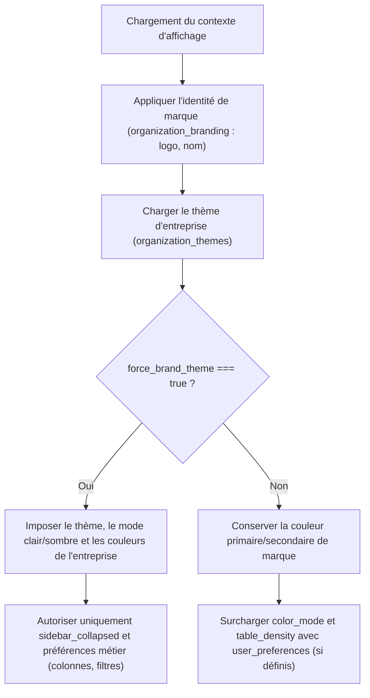

# Système de Design et Personnalisation Visuelle (Design System)

> **Version :** 1.1  
> **Produit :** G-Stock  
> **Portée :** Architecture des Design Tokens, thèmes prédéfinis, gouvernance marque/utilisateur, accessibilité WCAG 2.2 AA et responsive design.

---

## 1. Philosophie et Principes

La personnalisation visuelle est une fonctionnalité de première classe dans **G-Stock**. Chaque entreprise cliente peut adapter l'identité visuelle de son espace de travail (couleurs, thème, densité, rayons de bordure, logo) sans jamais altérer le code source, compromettre la lisibilité ou impacter les autres organisations de la plateforme.

Principes directeurs :
- **Zéro CSS libre arbitraire :** La personnalisation repose exclusivement sur un catalogue strict de **CSS Custom Properties (Design Tokens)** validés côté serveur. Aucune injection de feuille de style externe ou d'URL arbitraire n'est permise dans les tokens.
- **Séparation stricte avec le métier :** Les préférences visuelles et de marque n'influencent jamais les règles du moteur de stock, de valorisation ou d'autorisation.
- **Accessibilité garantie :** Toute couleur personnalisée soumise par un administrateur d'entreprise est vérifiée par un calculateur de luminance relative afin de garantir un ratio de contraste conforme à **WCAG 2.2 AA** (et **AAA** pour le thème `high-contrast`).
- **Zéro flash visuel (FOUC) :** Le thème résolu est injecté dès le rendu initial sur l'élément racine du document avant le premier affichage (First Contentful Paint).

---

## 2. Catalogue Central des CSS Custom Properties (Design Tokens)

Tous les composants d'interface (boutons, tableaux, cartes, modales, graphiques Recharts, barre latérale) consomment exclusivement les variables CSS suivantes déclarées sur `:root` ou sur le conteneur racine de l'application (`[data-gstock-theme]`).

### 2.1 Tokens de Couleurs

| Token CSS | Rôle sémantique | Format accepté | Valeur de référence (`gstock-classic` Clair) | Valeur de référence (`gstock-classic` Sombre) |
| :--- | :--- | :--- | :--- | :--- |
| `--color-primary` | Couleur primaire de marque (actions principales, états actifs, focus) | Hex (`#RRGGBB`) | `#059669` (Émeraude 600) | `#10B981` (Émeraude 500) |
| `--color-primary-foreground` | Texte et icônes posés sur `--color-primary` | Hex (`#RRGGBB`) | `#FFFFFF` | `#064E3B` |
| `--color-secondary` | Actions secondaires, badges neutres structurants | Hex (`#RRGGBB`) | `#0F172A` (Ardoise 900) | `#334155` (Ardoise 700) |
| `--color-accent` | Mise en avant ponctuelle, indicateurs actifs, survols accentués | Hex (`#RRGGBB`) | `#10B981` (Émeraude 500) | `#34D399` (Émeraude 400) |
| `--color-background` | Fond général de l'application | Hex (`#RRGGBB`) | `#F8FAFC` (Ardoise 50) | `#090D16` |
| `--color-surface` | Fond des cartes, modales, panneaux et tableaux | Hex (`#RRGGBB`) | `#FFFFFF` | `#111827` (Gris 900) |
| `--color-surface-muted` | En-têtes de tableaux, zones secondaires, lignes paires, fonds désactivés | Hex (`#RRGGBB`) | `#F1F5F9` (Ardoise 100) | `#1E293B` (Ardoise 800) |
| `--color-text` | Texte principal à haute lisibilité | Hex (`#RRGGBB`) | `#0F172A` (Ardoise 900) | `#F8FAFC` (Ardoise 50) |
| `--color-text-muted` | Texte secondaire, légendes, métadonnées, placeholders | Hex (`#RRGGBB`) | `#475569` (Ardoise 600) | `#94A3B8` (Ardoise 400) |
| `--color-border` | Bordures de cartes, séparateurs de tableaux et contours de champs | Hex (`#RRGGBB`) | `#E2E8F0` (Ardoise 200) | `#334155` (Ardoise 700) |
| `--color-success` | État de validation, stock disponible, mouvement confirmé | Hex (`#RRGGBB`) | `#15803D` (Vert 700) | `#22C55E` (Vert 500) |
| `--color-warning` | Alerte de seuil bas, écart d'inventaire modéré, abonnement `past_due` | Hex (`#RRGGBB`) | `#B45309` (Ambre 700) | `#F59E0B` (Ambre 500) |
| `--color-danger` | Rupture de stock, erreur de saisie, suppression, blocage critique | Hex (`#RRGGBB`) | `#B91C1C` (Rouge 700) | `#EF4444` (Rouge 500) |
| `--color-info` | Aide contextuelle, transfert en cours, notification informative | Hex (`#RRGGBB`) | `#1D4ED8` (Bleu 700) | `#3B82F6` (Bleu 500) |

### 2.2 Tokens de Géométrie, Mise en Page et Typographie

| Token CSS | Rôle sémantique | Échelle autorisée | Valeur par défaut (`standard`) |
| :--- | :--- | :--- | :--- |
| `--radius-card` | Rayon de courbure des cartes, panneaux et modales | `compact`: `0.25rem` (4px) `standard`: `0.5rem` (8px) `rounded`: `0.875rem` (14px) | `0.5rem` (8px) |
| `--radius-control` | Rayon de courbure des boutons, champs de saisie, sélecteurs et badges | `compact`: `0.1875rem` (3px) `standard`: `0.375rem` (6px) `rounded`: `0.625rem` (10px) | `0.375rem` (6px) |
| `--sidebar-width` | Largeur de la barre latérale de navigation desktop | `standard`: `16rem` (256px) `compact`: `13.5rem` (216px) `collapsed`: `4.25rem` (68px) | `16rem` (256px) |
| `--table-density` | Espacement vertical (padding) des cellules de tableaux (`td`, `th`) | `comfortable`: `0.875rem 1rem` `standard`: `0.625rem 0.875rem` `compact`: `0.375rem 0.625rem` | `0.625rem 0.875rem` |
| `--font-scale` | Facteur multiplicatif de la taille typographique de base | `small`: `0.9375` (15px) `standard`: `1` (16px) `large`: `1.0625` (17px) | `1` (16px) |

---

## 3. Définition Détaillée des 6 Thèmes Prédéfinis

Chaque thème prédéfini possède une déclinaison **Clair (`light`)** et **Sombre (`dark`)** intégralement calibrée pour respecter les exigences de contraste WCAG.

### 3.1 `gstock-classic` — Émeraude (Thème par défaut)
Identité équilibrée, neutre et professionnelle, alliant des gris ardoise froids à un vert émeraude évoquant la maîtrise opérationnelle et la précision logistique.

| Token | Mode Clair (`light`) | Mode Sombre (`dark`) |
| :--- | :--- | :--- |
| `--color-primary` | `#059669` | `#10B981` |
| `--color-primary-foreground` | `#FFFFFF` | `#064E3B` |
| `--color-secondary` | `#0F172A` | `#334155` |
| `--color-accent` | `#10B981` | `#34D399` |
| `--color-background` | `#F8FAFC` | `#090D16` |
| `--color-surface` | `#FFFFFF` | `#111827` |
| `--color-surface-muted` | `#F1F5F9` | `#1E293B` |
| `--color-text` | `#0F172A` | `#F8FAFC` |
| `--color-text-muted` | `#475569` | `#94A3B8` |
| `--color-border` | `#E2E8F0` | `#334155` |

### 3.2 `ocean` — Bleu / Cyan
Palette maritime et industrielle adaptée aux entreprises de transport, négoce international, distribution et chaîne du froid.

| Token | Mode Clair (`light`) | Mode Sombre (`dark`) |
| :--- | :--- | :--- |
| `--color-primary` | `#0284C7` | `#38BDF8` |
| `--color-primary-foreground` | `#FFFFFF` | `#082F49` |
| `--color-secondary` | `#0C4A6E` | `#1E3A5F` |
| `--color-accent` | `#0891B2` | `#22D3EE` |
| `--color-background` | `#F0F9FF` | `#07111E` |
| `--color-surface` | `#FFFFFF` | `#0F1E32` |
| `--color-surface-muted` | `#E0F2FE` | `#162B46` |
| `--color-text` | `#082F49` | `#F0F9FF` |
| `--color-text-muted` | `#336280` | `#93C5FD` |
| `--color-border` | `#BAE6FD` | `#1E3A5F` |

### 3.3 `graphite` — Ardoise / Noir
Esthétique sobre, technique et minimaliste, privilégiée par les secteurs de l'industrie mécanique, des pièces automobiles et de l'électronique.

| Token | Mode Clair (`light`) | Mode Sombre (`dark`) |
| :--- | :--- | :--- |
| `--color-primary` | `#18181B` | `#E4E4E7` |
| `--color-primary-foreground` | `#FFFFFF` | `#09090B` |
| `--color-secondary` | `#3F3F46` | `#27272A` |
| `--color-accent` | `#52525B` | `#A1A1AA` |
| `--color-background` | `#F4F4F5` | `#09090B` |
| `--color-surface` | `#FFFFFF` | `#121215` |
| `--color-surface-muted` | `#E4E4E7` | `#1C1C21` |
| `--color-text` | `#09090B` | `#FAFAFA` |
| `--color-text-muted` | `#52525B` | `#A1A1AA` |
| `--color-border` | `#D4D4D8` | `#27272A` |

### 3.4 `violet` — Violet / Lavande
Atmosphère moderne et créative, adaptée aux secteurs du prêt-à-porter, de la cosmétique, des accessoires et du commerce spécialisé.

| Token | Mode Clair (`light`) | Mode Sombre (`dark`) |
| :--- | :--- | :--- |
| `--color-primary` | `#6D28D9` | `#A78BFA` |
| `--color-primary-foreground` | `#FFFFFF` | `#1E1038` |
| `--color-secondary` | `#2E1065` | `#3B1F7A` |
| `--color-accent` | `#8B5CF6` | `#C4B5FD` |
| `--color-background` | `#FAF5FF` | `#0D0917` |
| `--color-surface` | `#FFFFFF` | `#17112A` |
| `--color-surface-muted` | `#F3E8FF` | `#231A3E` |
| `--color-text` | `#1E1B4B` | `#FAF5FF` |
| `--color-text-muted` | `#5B4B8A` | `#C4B5FD` |
| `--color-border` | `#E9D5FF` | `#36285E` |

### 3.5 `sand` — Beige / Tons Chauds
Palette organique et chaleureuse réduisant la fatigue visuelle en environnement lumineux, idéale pour l'agroalimentaire, la restauration, l'artisanat et les matériaux naturels.

| Token | Mode Clair (`light`) | Mode Sombre (`dark`) |
| :--- | :--- | :--- |
| `--color-primary` | `#9A3412` | `#FB923C` |
| `--color-primary-foreground` | `#FFFFFF` | `#2A1205` |
| `--color-secondary` | `#431407` | `#443326` |
| `--color-accent` | `#D97706` | `#FBBF24` |
| `--color-background` | `#FAF7F2` | `#14110E` |
| `--color-surface` | `#FFFFFF` | `#1F1A15` |
| `--color-surface-muted` | `#F3EDE2` | `#2C251E` |
| `--color-text` | `#1C1917` | `#FAF7F2` |
| `--color-text-muted` | `#57534E` | `#D6CFC7` |
| `--color-border` | `#E7E0D3` | `#3D342B` |

### 3.6 `high-contrast` — Contraste Renforcé (WCAG 2.2 AAA)
Conçu pour les environnements difficiles (entrepôts très éclairés ou sombres, terminaux mobiles industriels, utilisateurs malvoyants). Tous les ratios texte/fond dépassent **7:1 (WCAG AAA)** et les bordures sont doublées en visibilité.

| Token | Mode Clair (`light`) | Mode Sombre (`dark`) |
| :--- | :--- | :--- |
| `--color-primary` | `#0038A8` | `#FFCC00` |
| `--color-primary-foreground` | `#FFFFFF` | `#000000` |
| `--color-secondary` | `#000000` | `#FFFFFF` |
| `--color-accent` | `#0052CC` | `#00FFFF` |
| `--color-background` | `#FFFFFF` | `#000000` |
| `--color-surface` | `#FFFFFF` | `#0A0A0A` |
| `--color-surface-muted` | `#EBEBEB` | `#1F1F1F` |
| `--color-text` | `#000000` | `#FFFFFF` |
| `--color-text-muted` | `#1F1F1F` | `#E5E5E5` |
| `--color-border` | `#000000` | `#FFFFFF` |
| `--color-success` | `#005A1E` | `#4DFF88` |
| `--color-warning` | `#7A3E00` | `#FFD11A` |
| `--color-danger` | `#990000` | `#FF6666` |
| `--color-info` | `#0038A8` | `#66B2FF` |

---

## 4. Modes Clair, Sombre, Système et Prévention du FOUC

### 4.1 Modes d'affichage supportés
1. **`light` (Clair) :** Mode par défaut recommandé pour un usage bureautique classique.
2. **`dark` (Sombre) :** Réduit l'éblouissement lors des opérations nocturnes en entrepôt ou sur postes fixes.
3. **`system` (Système) :** Synchronise dynamiquement le mode avec la requête média du système d'exploitation `window.matchMedia('(prefers-color-scheme: dark)')` et écoute ses changements en temps réel.

### 4.2 Stratégie de prévention du flash visuel (FOUC — Flash of Unstyled Content)
Pour éviter tout clignotement blanc ou changement brutal de palette lors du chargement initial ou du rafraîchissement d'une page Next.js :
1. **Cookie / Stockage local synchronisé :** Lors de l'authentification ou de la mise à jour des préférences, un objet compact sérialisé contenant les tokens résolus (`gstock_theme_snapshot`) est stocké dans un cookie lisible par le serveur Next.js ainsi que dans `localStorage`.
2. **Injection SSR dans `<head>` :** Le Layout racine de Next.js lit le contexte de thème et injecte une balise `<style id="gstock-theme-vars">` contenant les variables CSS directement dans le HTML serveur, accompagnée d'un script inline synchrone minimaliste avant l'hydratation React.
3. **Résolution immédiate du mode `system` :** Le script bloquant d'en-tête (~350 octets) évalue `prefers-color-scheme` avant le premier rendu du `<body>` et positionne immédiatement l'attribut `data-color-mode="light|dark"` et les variables CSS correspondantes.
4. **Fallback sûr :** Si les données locales sont absentes ou corrompues, le thème de référence `gstock-classic` en mode `light` est appliqué instantanément sans erreur bloquante.

---

## 5. Gouvernance et Portée des Préférences : Entreprise vs Utilisateur

G-Stock distingue strictement l'identité de marque de l'entreprise des préférences ergonomiques de chaque collaborateur.

### 5.1 Entités de persistance
- **`organization_branding` :** Identité de l'entreprise (`display_name`, `logo_asset_id`, `favicon_asset_id`). Toujours commune à tous les membres de l'organisation.
- **`organization_themes` :** Configuration visuelle par défaut de l'entreprise (`theme_preset`, `color_mode_default`, `design_tokens`, `card_style`, `radius_scale`, `table_density`, `font_scale`, `sidebar_style`, `force_brand_theme`).
- **`user_preferences` :** Préférences individuelles d'un utilisateur pour une organisation donnée (`color_mode`, `table_density`, `sidebar_collapsed`, `locale`, `preferences_json`).

### 5.2 Règle de résolution et option `force_brand_theme`

L'algorithme de résolution applique l'ordre de priorité suivant :

| Paramètre | Source par défaut | Surchargeable par l'utilisateur (`force_brand_theme = false`) | Surchargeable par l'utilisateur (`force_brand_theme = true`) |
| :--- | :--- | :--- | :--- |
| Logo & Nom de marque | `organization_branding` | Non (jamais) | Non (jamais) |
| Palette de marque (`--color-primary`, etc.) | `organization_themes` | Non (protège l'identité de l'entreprise) | Non |
| Mode d'affichage (`light`, `dark`, `system`) | `organization_themes.color_mode_default` | **Oui** (`user_preferences.color_mode`) | Non (sauf bascule d'accessibilité `high-contrast`) |
| Densité des tableaux (`--table-density`) | `organization_themes.table_density` | **Oui** (`user_preferences.table_density`) | Non |
| État replié de la sidebar (`sidebar_collapsed`) | `false` | **Oui** | **Oui** |
| Vues enregistrées, filtres et colonnes | `saved_views` / `user_preferences` | **Oui** | **Oui** |

---

## 6. Règles d'Accessibilité (WCAG 2.2 AA)

### 6.1 Validation mathématique du contraste des couleurs
Toute modification de palette via `PUT /api/v1/settings/appearance` est validée côté serveur avant persistance :
1. Conversion des couleurs hexadécimales `#RRGGBB` en composantes linéarisées $R, G, B \in [0, 1]$.
2. Calcul de la luminance relative selon la formule officielle W3C :
   $$L = 0.2126 \times R_{lin} + 0.7152 \times G_{lin} + 0.0722 \times B_{lin}$$
3. Calcul du ratio de contraste entre deux couleurs de luminances $L_1$ (plus claire) et $L_2$ (plus sombre) :
   $$C = \frac{L_1 + 0.05}{L_2 + 0.05}$$
4. **Seuils obligatoires vérifiés côté serveur :**
   - `--color-text` sur `--color-background` et `--color-surface` : **$C \ge 4.5:1$** (et $\ge 7.0:1$ pour `high-contrast`).
   - `--color-text-muted` sur `--color-background` et `--color-surface` : **$C \ge 4.5:1$** pour le texte de taille normale.
   - `--color-primary-foreground` sur `--color-primary` : **$C \ge 4.5:1$** (ou auto-calcul serveur entre `#FFFFFF` et `#0F172A` si non fourni).
   - Contrôles graphiques et bordures actives : **$C \ge 3.0:1$**.

### 6.2 Sémantique non-colorimétrique, Clavier et Mouvement
- **Indépendance de la couleur :** Aucun statut (rupture, seuil bas, mouvement validé, erreur) n'est transmis par la couleur seule ; chaque badge associe systématiquement une **icône explicite** et un **libellé textuel**.
- **Navigation au clavier :**
  - Ordre de tabulation logique (`tabindex` naturel).
  - Anneau de focus haute visibilité (`outline: 2px solid var(--color-primary); outline-offset: 2px`) sur tous les éléments interactifs via `:focus-visible`.
  - Piégeage du focus (`focus trap`) dans les modales et tiroirs (drawers), avec fermeture via la touche `Escape`.
- **Respect de `prefers-reduced-motion` :**
  - Si l'utilisateur a activé `prefers-reduced-motion: reduce` au niveau de son OS ou dans ses préférences G-Stock, toutes les transitions d'interface et animations de graphiques Recharts (`isAnimationActive={false}`) sont désactivées instantanément.

---

## 7. Responsive Design et Ergonomie Multi-Support

L'interface G-Stock s'adapte aux postes de bureau, tablettes logistiques et smartphones de terrain sans aucun débordement horizontal (`overflow-x: hidden` maîtrisé au niveau layout).

### 7.1 Points de rupture (Breakpoints)
- **Mobile (`< 768px`) :** Navigation par barre inférieure ou menu tiroir (drawer), formulaires mono-colonne, zones tactiles d'au moins `44x44px`.
- **Tablette (`768px – 1023px`) :** Barre latérale repliée par défaut en mode icônes (`68px`), grilles à 2 colonnes pour les KPI, tableaux condensés.
- **Desktop (`>= 1024px`) :** Barre latérale complète (`256px` ou `216px`), repliable à tout moment par l'utilisateur, tableaux multi-colonnes complets avec tri, filtres et actions en ligne.

### 7.2 Comportement des composants clés

| Composant | Comportement Desktop (`>= 1024px`) | Comportement Mobile & Tablette (`< 1024px`) |
| :--- | :--- | :--- |
| **Navigation principale** | Barre latérale fixe à gauche, repliable (`--sidebar-width`), avec sélecteur d'organisation et modules actifs. | Tiroir latéral (Sheet/Drawer) accessible depuis l'en-tête + barre d'actions rapides pour les opérations fréquentes. |
| **Tableaux de données** | Tableau complet avec en-têtes figés, tri serveur, sélection de densité (`comfortable`, `standard`, `compact`). | Transformation automatique en **cartes empilées lisibles** (affichage SKU, nom, stock disponible, badge d'état et menu d'action) ou défilement horizontal confiné au conteneur du tableau selon la préférence utilisateur. |
| **Flux d'inventaire physique** | Vue tabulaire comparative (Quantité attendue, Quantité comptée, Écart calculé en temps réel, filtre par emplacement). | **Mode Comptage Rapide Mobile :** Cartes plein écran par emplacement avec boutons `+` / `-` larges, saisie numérique directe (`inputmode="decimal"`) et passage rapide au produit suivant. |
| **Écran de personnalisation** | Vue divisée en 2 colonnes : contrôles à gauche, aperçu interactif en direct (sidebar, boutons, cartes, tableau, graphique) à droite. | Onglets basculables entre « Réglages » et « Aperçu en direct » avec barre d'actions fixe en bas (« Enregistrer », « Réinitialiser »). |
