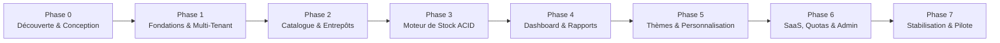

# Feuille de Route Produit et Plan de Réalisation (Roadmap)

> **Version :** 1.1  
> **Produit :** G-Stock  
> **Portée :** Découpage séquentiel des Phases 0 à 7 du MVP avec livrables et critères d'acceptation vérifiables, suivi des évolutions post-MVP prévues par l'architecture.

---

## 1. Vue d'Ensemble du Cycle de Réalisation MVP (Phases 0 à 7)

Le développement de **G-Stock** progresse par **tranches verticales complètes** (base de données, API, validation, interface et tests automatisés avancent de concert à chaque phase).

---

## 2. Détail des Phases 0 à 7, Livrables et Critères d'Acceptation

### Phase 0 — Découverte, Architecture et Conception
- **Périmètre des travaux :**
  - Inspection complète du dépôt, définition des conventions de code et de nommage.
  - Rédaction des 12 documents de référence dans `docs/` (`PRODUCT_SPEC.md`, `ARCHITECTURE.md`, `DATABASE_SCHEMA.md`, `STOCK_ENGINE.md`, `TENANCY_SECURITY.md`, `DESIGN_SYSTEM.md`, `API.md`, `BILLING.md`, `TEST_PLAN.md`, `DEPLOYMENT.md`, `ROADMAP.md`, `DECISIONS.md`).
  - Définition formelle des invariants du moteur de stock, du modèle relationnel PostgreSQL et du système de Design Tokens.
- **Livrables :** Dossier `docs/` complet, schéma cible et journal des décisions d'architecture (ADR).
- **Critères d'acceptation vérifiables :**
  - [x] Les 12 documents d'architecture et de spécification sont présents et cohérents entre eux.
  - [x] Les règles métier ambiguës disposent de politiques configurables par défaut (`negative_stock_policy`, `costing_method`, `force_brand_theme`).

---

### Phase 1 — Fondations Techniques, Identité et Isolation Multi-Tenant
- **Périmètre des travaux :**
  - Mise en place du monorepo `pnpm` + `Turborepo` (`apps/web`, `apps/api`, `packages/database`, `packages/validation`, `packages/types`, `packages/ui`, `packages/config`).
  - Configuration Docker Compose (`postgres:16-alpine`), schéma Prisma initial et migrations SQL.
  - Authentification complète (`/auth/register`, `/auth/login`, `/auth/logout`, `/me`) avec hachage robuste des mots de passe et gestion de session (`HttpOnly` / Bearer).
  - Création d'organisations, gestion des membres (`memberships`), rôles et permissions explicites (`roles`, `permissions`, `role_permissions`, `membership_roles`).
  - Middleware serveur de résolution du contexte `X-Organization-Id` et contrôle d'accès RBAC.
- **Livrables :** Monorepo fonctionnel, base PostgreSQL migrée, authentification et isolation multi-entreprises opérationnelles.
- **Critères d'acceptation vérifiables :**
  - [x] `pnpm lint`, `pnpm typecheck` et `pnpm build` réussissent sans erreur.
  - [x] Un utilisateur authentifié peut créer une entreprise, choisir son profil d'activité et inviter un collaborateur.
  - [x] Un test automatisé prouve qu'un membre de l'Organisation A reçoit `403 FORBIDDEN` s'il tente d'agir sur l'Organisation B.

---

### Phase 2 — Catalogue Produits, Unités et Entrepôts
- **Périmètre des travaux :**
  - Gestion des catégories hiérarchiques (`categories`) et des unités de mesure avec conversions validées (`units_of_measure`, `unit_conversions`).
  - CRUD complet des produits (`products`, `product_variants` simples, attributs métier) avec unicité du `sku` par organisation.
  - Gestion des entrepôts (`warehouses`) et emplacements (`locations` : réception, stockage, expédition, quarantaine).
  - Recherche plein texte, filtres multi-critères, tri par liste blanche et pagination côté serveur.
  - Écrans responsive Desktop (tableaux) et Mobile (cartes).
- **Livrables :** API et interface complètes du catalogue et de la topologie logistique.
- **Critères d'acceptation vérifiables :**
  - [x] Impossible de créer deux produits avec le même `sku` dans la même organisation (`409 DUPLICATE_SKU`), mais autorisé dans deux organisations distinctes.
  - [x] Les conversions d'unités de dimensions incompatibles (ex. `KG` vers `L`) sont rejetées (`422 UNIT_DIMENSION_MISMATCH`).
  - [x] La création d'un entrepôt initialise automatiquement son emplacement principal par défaut.

---

### Phase 3 — Moteur de Stock Transactionnel et Inventaires
- **Périmètre des travaux :**
  - Implémentation transactionnelle des mouvements (`receipt`, `issue`, `transfer`, `adjustment`, `opening_balance`, `reversal`) et mise à jour atomique de `inventory_balances`.
  - Verrouillage pessimiste (`SELECT ... FOR UPDATE`) pour prévenir les conditions de course (race conditions).
  - Gestion de l'idempotence via `idempotency_keys` (`Idempotency-Key`).
  - Sessions d'inventaire physique (`inventories`, `inventory_lines`), saisie des comptages (`/counts`, vue mobile de comptage rapide) et validation transactionnelle des écarts (`/validate`).
  - Journalisation systématique dans `audit_logs`.
- **Livrables :** Moteur de stock ACID audité et module d'inventaire physique.
- **Critères d'acceptation vérifiables :**
  - [x] Les 10 invariants du moteur de stock sont validés par les tests unitaires et d'intégration PostgreSQL.
  - [x] Une requête concurrente dépassant le stock disponible est bloquée (`409 INSUFFICIENT_STOCK`) sans jamais produire de solde négatif.
  - [x] Un mouvement validé ne peut être corrigé que par `/stock/movements/:id/reverse`.
  - [x] La validation d'un inventaire génère atomiquement le mouvement d'ajustement correspondant aux écarts constatés.

---

### Phase 4 — Tableau de Bord, Alertes, Rapports et Imports/Exports
- **Périmètre des travaux :**
  - Calcul serveur des KPI sur données persistées (`/reports/overview`, `/reports/stock-value`).
  - Détection temps réel des alertes de rupture (`OUT_OF_STOCK`) et de seuil bas (`LOW_STOCK`) sur `/alerts/stock`.
  - Graphiques sobres et accessibles avec Recharts (adaptés aux tokens du thème actif).
  - Export CSV des produits, soldes et mouvements ; import CSV de produits validé ligne par ligne.
- **Livrables :** Dashboard opérationnel, centre d'alertes et rapports de valorisation.
- **Critères d'acceptation vérifiables :**
  - [x] Tous les chiffres du tableau de bord proviennent exclusivement des tables PostgreSQL (zéro donnée fictive codée en dur).
  - [x] La valeur du stock indique clairement le pourcentage de couverture des coûts d'achat renseignés.
  - [x] Les états de chargement (skeletons), états vides et états d'erreur sont gérés sur chaque vue.

---

### Phase 5 — Système de Design, Thèmes et Personnalisation d'Entreprise
- **Périmètre des travaux :**
  - Implémentation du catalogue central des 19 Design Tokens CSS et des 6 thèmes prédéfinis (`gstock-classic`, `ocean`, `graphite`, `violet`, `sand`, `high-contrast`) en modes `light`, `dark` et `system`.
  - Écran **Paramètres → Apparence et personnalisation** avec aperçu live (sidebar, cartes, boutons, tableau, graphique), sélecteurs de couleurs hexadécimales, densité, rayons, police et upload de logo.
  - Validation serveur du ratio de contraste WCAG 2.2 AA ($\ge 4.5:1$).
  - Gouvernance marque vs utilisateur (`organization_branding`, `organization_themes`, `force_brand_theme`, `user_preferences`) et prévention du flash visuel (FOUC).
- **Livrables :** Moteur de personnalisation visuelle multi-tenant complet et persistant.
- **Critères d'acceptation vérifiables :**
  - [x] Le changement de thème d'une organisation persiste après rechargement sans affecter les autres entreprises.
  - [x] Une combinaison de couleurs au contraste insuffisant est rejetée par l'API avec `422 WCAG_CONTRAST_VIOLATION`.
  - [x] Lorsque `force_brand_theme = true`, les membres ne peuvent pas écraser le thème imposé par l'entreprise.

---

### Phase 6 — Modèle SaaS, Facturation, Quotas et Administration Plateforme
- **Périmètre des travaux :**
  - Moteur de droits SaaS à 5 niveaux et suivi des compteurs `usage_counters`.
  - Configuration des plans `starter`, `pro`, `enterprise` et de leurs quotas (`max_users`, `max_warehouses`, `max_products`, `custom_branding`, `advanced_inventory`, `audit_logs`).
  - Implémentation de l'interface `BillingProvider` avec `StripeBillingProvider` et `DevSimulatedBillingProvider` (clairement signalé dans l'UI).
  - Traitement idempotent des webhooks (`/billing/webhooks/:provider`) et politique d'accès en lecture seule sur abonnement expiré (`canceled` / `suspended`).
  - Espace d'administration de la plateforme (`/admin/*`) séparé de l'espace client.
- **Livrables :** Gestion commerciale SaaS complète et back-office opérateur G-Stock.
- **Critères d'acceptation vérifiables :**
  - [x] Le dépassement d'un quota du plan bloque la création avec `403 QUOTA_EXCEEDED` et un message explicite.
  - [x] Une entreprise dont l'abonnement est `canceled` conserve la lecture de toutes ses données mais ses écritures sont bloquées (`402 SUBSCRIPTION_READ_ONLY`).
  - [x] L'espace `/admin` permet de modifier dynamiquement les quotas d'un plan et d'auditer les organisations.

---

### Phase 7 — Stabilisation, Sécurité, Sauvegardes et Préparation Pilote
- **Périmètre des travaux :**
  - Exécution complète des tests unitaires, d'intégration et des 16 scénarios E2E Playwright (Desktop & Mobile).
  - Audit de sécurité (en-têtes HTTP Helmet, CORS, rate-limiting, validation des uploads, expurgation des logs).
  - Validation des scripts de sauvegarde chiffrée `pg_dump` et test réel de restauration.
  - Vérification finale de la documentation et de la spécification OpenAPI `/api/v1/openapi.json`.
- **Livrables :** Version 1.1 prête pour le déploiement pilote auprès d'entreprises clientes.
- **Critères d'acceptation vérifiables :**
  - [x] 100 % des tests unitaires, d'intégration et des 16 scénarios E2E critiques passent au vert.
  - [x] Aucun bouton décoratif inactif ni secret exposé dans le dépôt ou les logs.

---

## 3. Évolutions Post-MVP Prévues dans l'Architecture

Bien qu'exclues du périmètre MVP initial pour garantir une livraison rapide et irréprochable du noyau, les fonctionnalités suivantes ont été anticipées dès la conception du schéma de données et des services :

| Module Post-MVP | Points d'Ancrage Architecturaux Déjà Prévus dans le MVP |
| :--- | :--- |
| **1. Suivi des Lots, Dates d'Expiration (DLC/DLUO) & FEFO** | Colonne `products.tracking_mode` (`NONE`, `LOT`, `SERIAL`, `LOT_EXPIRY`). Permettra d'ajouter la table `inventory_lots` et d'allouer automatiquement les sorties selon la règle *First-Expired, First-Out (FEFO)* pour les pharmacies et métiers de bouche. |
| **2. Numéros de Série Unitaires (`SERIAL`)** | Supporté par `tracking_mode = 'SERIAL'` : chaque unité physique (électronique, outillage, pièces auto haute valeur) pourra être tracée individuellement de la réception jusqu'à la sortie. |
| **3. Variantes Matricielles Complexes** | Tables `product_variants`, `product_attribute_definitions` et `product_attribute_values` permettant de générer et gérer des grilles Taille × Couleur × Matière (prêt-à-porter, chaussures). |
| **4. Achats, Fournisseurs & Réceptions Partielles** | Les bons de commande fournisseurs (`purchase_orders`) appelleront directement le service `StockService.createReceipt()` lors des réceptions partielles ou totales, sans modifier les invariants du moteur de stock. |
| **5. Ventes, Commandes Clients & Point de Vente (POS)** | Utilisation de la colonne `inventory_balances.reserved` déjà présente pour réserver le stock à la commande avant de déclencher un mouvement `issue` à l'expédition ou au passage en caisse. |
| **6. Nomenclatures (BOM), Recettes & Production** | Assemblage ou transformation consommant des matières premières via un mouvement `issue` et créditant le produit fini via un mouvement `receipt` au sein d'une même transaction atomique. |
| **7. API Publique & Intégrations Comptables / ERP** | Exposition de clés API par organisation (scopes restreints, rate-limiting dédié) et d'un outbox transactionnel de webhooks sortants pour synchroniser les logiciels comptables et e-commerce. |
| **8. Application Mobile Native & Scan Matériel** | Architecture REST `/api/v1` stateless compatible avec une application mobile React Native / Android équipée de lecteurs laser Zebra/Honeywell et du scan caméra WebRTC. |
