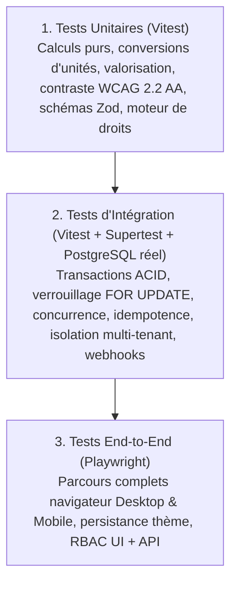

# Plan de Tests et Stratégie d'Assurance Qualité (QA)

> **Version :** 1.1  
> **Produit :** G-Stock  
> **Portée :** Pyramide de tests (Vitest, Supertest + PostgreSQL, Playwright), matrice de couverture des invariants critiques et 16 scénarios E2E prioritaires.

---

## 1. Philosophie et Pyramide de Tests

Dans une plateforme de gestion des stocks multi-entreprises comme **G-Stock**, une erreur de concurrence sur un solde ou une fuite d'isolation entre deux organisations clientes est inacceptable. La stratégie d'assurance qualité repose sur une pyramide de tests automatisés exécutée à chaque étape du développement et dans le pipeline CI.



### 1.1 Couche 1 : Tests Unitaires (`Vitest`)
- **Cible :** Fonctions pures du domaine métier, validateurs Zod (`@gstock/validation`), calculateurs de contraste WCAG, convertisseurs d'unités, règles d'évaluation des permissions et quotas.
- **Exigence :** Exécution ultra-rapide (`< 5s`), aucun appel réseau externe, déterminisme absolu sur les décimaux.

### 1.2 Couche 2 : Tests d'Intégration (`Vitest` + `Supertest` + PostgreSQL réel)
- **Cible :** Routes Express (`/api/v1/*`), services transactionnels Prisma et contraintes SQL PostgreSQL.
- **Règle impérative :** On ne « mocke » jamais PostgreSQL pour tester le moteur de stock. Les tests d'intégration s'exécutent contre une base PostgreSQL dédiée de test afin de valider les verrous `SELECT ... FOR UPDATE`, les contraintes `CHECK (on_hand >= 0)`, les clés uniques composites et les rollbacks automatiques.

### 1.3 Couche 3 : Tests End-to-End (`Playwright`)
- **Cible :** Application complète (`apps/web` + `apps/api` + PostgreSQL) pilotée dans un navigateur réel Chromium (viewports Desktop `1440x900` et Mobile `390x844`).
- **Exigence :** Vérifie qu'aucune opération n'est simulée uniquement en mémoire côté client et que chaque action persiste après rechargement complet de la page (`page.reload()`).

---

## 2. Matrice de Couverture des Cas Critiques

| Domaine Critique | Invariant / Règle Métier Vérifiée | Niveau de Test | Méthode de Vérification Automatisée | Résultat Attendu |
| :--- | :--- | :--- | :--- | :--- |
| **Invariants du moteur de stock** | `available = on_hand - reserved` ; égalité stricte entre la somme algébrique des `stock_movement_lines` validées et `inventory_balances.on_hand`. | Unitaire & Intégration | Exécution d'une séquence de réceptions, sorties, transferts, ajustements et contrepassations (`reversal`), suivie d'une requête de réconciliation SQL. | Écart nul (`0.0000`) entre le grand livre des mouvements et la table des soldes. |
| **Atomicité des transferts** | Un transfert débite la source et crédite la destination dans la même transaction PostgreSQL. | Intégration | Injection d'une erreur sur la ligne de crédit ou d'une destination invalide au milieu d'un transfert. | Rollback intégral : l'emplacement source conserve exactement son solde initial. |
| **Concurrence & Verrouillage atomique** | Deux sorties simultanées sur un stock de `10` unités (chacune demandant `8` unités) ne doivent jamais passer toutes les deux. | Intégration (`Promise.all`) | Lancement simultané de 5 requêtes `POST /api/v1/stock/issues` concurrentes sur le même couple `(product_id, location_id)` via `Promise.all`. | Exactement 1 requête réussit (`201 Created`, solde final `2`), les autres échouent proprement avec `409 INSUFFICIENT_STOCK`. |
| **Non-négativité des soldes** | Lorsque `negative_stock_policy = 'DISALLOW'`, `on_hand` ne peut jamais devenir `< 0`. | Unitaire, Intégration & SQL | Tentative de sortie ou d'ajustement négatif supérieur au stock disponible (`available`). | Rejet `409 INSUFFICIENT_STOCK` au niveau service et contrainte SQL `CHECK (on_hand >= 0)` en dernier rempart. |
| **Idempotence des mutations** | Un retry réseau avec la même `Idempotency-Key` ne crée jamais de mouvement en double. | Intégration | Envoi de deux requêtes identiques `POST /api/v1/stock/receipts` avec la même clé `Idempotency-Key`, puis d'une troisième avec la même clé mais un corps différent. | Les 2 premières retournent le même `movement.id` (solde crédité 1 seule fois) ; la 3e retourne `409 IDEMPOTENCY_CONFLICT`. |
| **Immuabilité & Contrepassation** | Un mouvement validé ne peut être ni modifié ni supprimé ; sa correction passe par `/reverse`. | Intégration | Appel à `POST /api/v1/stock/movements/:id/reverse` sur une sortie validée, suivi d'une seconde tentative d'annulation du même mouvement. | Création d'un mouvement `reversal` lié par `reversal_of_movement_id` ; la seconde annulation est rejetée (`409 ALREADY_REVERSED`). |
| **Conversion d'unités** | Conversions exactes au sein d'une même dimension (`MASS`, `VOLUME`, `COUNT`, `LENGTH`) et rejet inter-dimensions. | Unitaire & Intégration | Conversion `1 Carton (12 Pcs) -> 12 Pcs` et tentative de conversion `Kilogramme -> Litre`. | Calcul décimal exact sans erreur d'arrondi flottant ; rejet `422 UNIT_DIMENSION_MISMATCH` entre Masse et Volume. |
| **Validation WCAG 2.2 AA des thèmes** | Rejet des couleurs personnalisées dont le ratio de contraste texte/fond est `< 4.5:1`. | Unitaire & Intégration | Soumission à `PUT /api/v1/settings/appearance` d'un texte gris clair `#CBD5E1` sur fond blanc `#FFFFFF` ($C \approx 1.48:1$), puis des 6 thèmes prédéfinis en modes `light` et `dark`. | Rejet `422 WCAG_CONTRAST_VIOLATION` pour la couleur illisible ; validation `200 OK` pour les 12 variantes des 6 thèmes prédéfinis. |
| **Isolation Multi-Tenant inter-organisations** | Une Entreprise A ne peut ni lire, ni modifier, ni référencer les produits, entrepôts, mouvements ou membres d'une Entreprise B. | Intégration & E2E | 1) Utilisateur de Org A envoie `X-Organization-Id: <Org_B_ID>`.<br>2) Utilisateur de Org A tente `GET /products/<Prod_B_ID>` ou un mouvement dans Org A référençant `locationId` de Org B. | 1) `403 FORBIDDEN`.<br>2) `404 RESOURCE_NOT_FOUND` (anti-énumération) et `400/403` sur référence croisée. |
| **RBAC & Périmètre Rôles** | Un `AUDITOR` (lecteur) ou `WAREHOUSE_OPERATOR` ne peut pas exécuter d'actions réservées à `STOCK_MANAGER` ou `OWNER`. | Intégration & E2E | Appels API avec un jeton `AUDITOR` sur `POST /products`, `POST /stock/adjustments`, `PUT /settings/appearance` et `/admin/*`. | Rejet systématique `403 FORBIDDEN` côté serveur. |
| **Quotas & Droits SaaS (5 niveaux)** | Blocage de création au dépassement de `max_products`, `max_warehouses`, `max_users` et mode lecture seule si `canceled`. | Unitaire, Intégration & E2E | Abonnement `starter` (`max_warehouses = 1`) : tentative de création d'un 2e entrepôt ; passage du statut à `canceled` puis tentative de réception de stock. | `403 QUOTA_EXCEEDED` au 2e entrepôt ; `402 SUBSCRIPTION_READ_ONLY` sur écriture avec abonnement expiré, tandis que `GET /stock/balances` reste `200 OK`. |

---

## 3. Les 16 Scénarios End-to-End (E2E) Prioritaires

Ces 16 scénarios constituent la suite de validation de bout en bout exigée par la spécification maîtresse de G-Stock.

| N° | Scénario E2E | Étapes Clés Exécutées par Playwright | Critères de Réussite Vérifiés |
| :---: | :--- | :--- | :--- |
| **01** | **Créer un compte utilisateur** | Remplissage du formulaire `/register` (nom, email unique, mot de passe robuste), soumission. | Compte créé en base, session initialisée (`HttpOnly` / token), redirection vers l'assistant de création d'entreprise. |
| **02** | **Créer une entreprise (Organisation)** | Saisie du nom de l'entreprise, devise (`EUR`), fuseau horaire (`Europe/Paris`), pays (`FR`). | Organisation persistée, utilisateur rattaché avec le rôle `OWNER`, abonnement initial créé. |
| **03** | **Sélectionner le profil métier** | Choix du profil d'activité (ex. *Commerce & Distribution* ou *Entrepôt & Logistique*) lors de l'onboarding. | `organization_settings.industry_profile` mis à jour, unités et catégories de démarrage préconfigurées. |
| **04** | **Ajouter un produit au catalogue** | Navigation vers `/products`, création d'un produit avec SKU `SKU-E2E-001`, unité `PCS`, coût `12.50`, seuil d'alerte `10`. | Produit visible dans la liste paginée et persistant après rechargement, stock initial affiché à `0`. |
| **05** | **Créer un entrepôt et ses emplacements** | Navigation vers `/warehouses`, création de l'entrepôt `ENT-NORD` et de deux emplacements `RACK-A1` et `RACK-B2`. | Entrepôt et emplacements persistés et sélectionnables dans les formulaires de mouvements. |
| **06** | **Enregistrer une réception de stock (`receipt`)** | Ouverture de `/stock/movements/new`, sélection du type *Entrée*, produit `SKU-E2E-001`, emplacement `RACK-A1`, quantité `50`, validation. | Mouvement `receipt` créé (`201`), ligne présente dans le journal des mouvements et dans `audit_logs`. |
| **07** | **Vérifier le solde de stock** | Consultation de `/stock/balances` et de la fiche produit `SKU-E2E-001`. | Solde `on_hand = 50`, `available = 50` sur `RACK-A1`, KPI du tableau de bord mis à jour. |
| **08** | **Effectuer une sortie de stock (`issue`)** | Enregistrement d'une sortie de `15` unités depuis `RACK-A1` (puis tentative d'une sortie invalide de `100` unités). | La sortie de `15` passe (`on_hand = 35`) ; la sortie de `100` affiche une erreur explicite de stock insuffisant sans modifier le solde. |
| **09** | **Transférer du stock entre emplacements (`transfer`)** | Transfert de `10` unités de `SKU-E2E-001` depuis `RACK-A1` vers `RACK-B2`. | `RACK-A1` passe à `25`, `RACK-B2` passe à `10`, le stock total de l'entreprise reste invariant à `35`. |
| **10** | **Réaliser et valider un inventaire physique** | Création d'un inventaire sur `ENT-NORD`, saisie d'une quantité comptée de `23` sur `RACK-A1` (attendu `25`, écart `-2`), validation de l'inventaire. | Écart `-2` enregistré, mouvement d'ajustement généré automatiquement, nouveau solde `RACK-A1` fixé à `23`. |
| **11** | **Changer les couleurs et le thème avec aperçu live** | Ouverture de `/settings/appearance`, sélection du thème `ocean`, passage en mode `dark`, densité `compact`. | L'aperçu live et les variables CSS (`--color-primary`, `--table-density`) se mettent à jour instantanément dans le DOM. |
| **12** | **Enregistrer le thème et vérifier sa persistance** | Clic sur « Enregistrer » dans `/settings/appearance`, puis rechargement complet du navigateur (`F5`). | Les tokens CSS du thème `ocean` et la densité `compact` sont restaurés dès le premier rendu sans flash visuel. |
| **13** | **Vérifier l'expérience responsive mobile** | Passage du viewport en `390x844` (iPhone), ouverture du menu mobile, consultation des produits en mode cartes et de l'écran de comptage rapide. | Aucun débordement horizontal (`scrollWidth <= clientWidth`), boutons tactiles accessibles et comptage d'inventaire opérationnel. |
| **14** | **Vérifier les rôles et permissions (RBAC)** | Connexion avec un membre ayant le rôle `AUDITOR` (lecteur seul). | Consultation des stocks et rapports autorisée ; boutons de création désactivés/masqués et appels directs `POST /stock/receipts` rejetés en `403`. |
| **15** | **Tenter d'accéder aux données d'une autre entreprise** | Création d'une seconde entreprise `Org B`, tentative par l'utilisateur de `Org A` de lire/modifier les produits ou stocks de `Org B`. | Isolation stricte confirmée : refus `403 FORBIDDEN` ou `404 RESOURCE_NOT_FOUND`, aucune donnée de `Org B` n'est divulguée. |
| **16** | **Simuler un abonnement expiré et vérifier la politique d'accès** | Passage de l'abonnement de l'entreprise au statut `canceled` (expiré), tentative de consultation puis de création de mouvement. | Bannière d'expiration visible, **lecture des stocks et exports conservés (`200 OK`)**, écritures bloquées (`402 SUBSCRIPTION_READ_ONLY`), aucune donnée supprimée. |

---

## 4. Commandes d'Exécution de la Suite de Tests

```bash
# 1. Exécuter l'ensemble des tests unitaires et de validation (Vitest)
pnpm test:unit

# 2. Exécuter les tests d'intégration API & PostgreSQL (Supertest + Vitest)
pnpm test:integration

# 3. Exécuter la suite complète des 16 scénarios End-to-End (Playwright)
pnpm test:e2e

# 4. Vérification complète avant mise en production (Lint + Typecheck + Tests + Build)
pnpm verify
```
